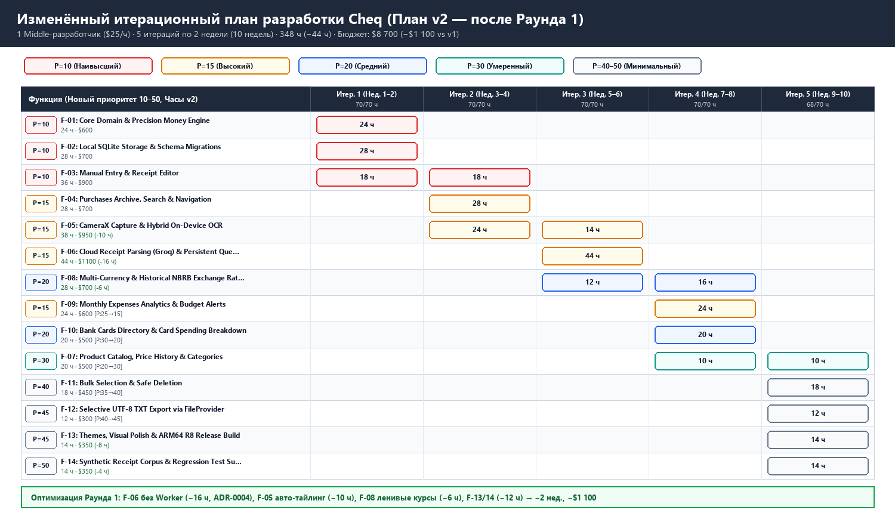

# Изменённый план реализации Cheq (План v2 — после Раунда 1)

**Статус:** Согласован в Раунде 1, замещён [Планом v3](plan-v3.md) по итогам Раунда 2  
**Версия:** 2.0  
**Автор:** А. В. Голуб, группа 434701 (`@Waveberry`)  
**Заказчик:** В. О. Кожемякин, группа 434701 (`@vlad200712`)  
**Основание:** [PR #3 — Раунд 1](https://github.com/Waveberry/SDLC-434701/pull/3), [ADR-0004 (accepted)](../adr/0004-groq-cloud-parsing-route-worker-vs-direct-https.md)

---

## 1. Итоги оптимизации и переприоритизации (Раунд 1)

| Блок | Было (v1) | Стало (v2) | Изменение | Причина изменения (согласовано в PR #3) |
|---|---|---|---|---|
| `F-06` | P=15, 60 ч ($1 500) | P=15, **44 ч** ($1 100) | **−16 ч (−$400)** | Отказ от прокси Cloudflare Worker в пользу прямого HTTPS к Groq (`ADR-0004`) |
| `F-05` | P=15, 48 ч ($1 200) | P=15, **38 ч** ($950) | **−10 ч (−$250)** | Отказ от ручного кроппера в пользу авто-тайлинга `OcrPreparation`, разбиение на 2 инкремента |
| `F-08` | P=20, 34 ч ($850) | P=20, **28 ч** ($700) | **−6 ч (−$150)** | Ленивая подгрузка исторических курсов НБРБ только по датам реальных чеков |
| `F-13` | P=45, 22 ч ($550) | P=45, **14 ч** ($350) | **−8 ч (−$200)** | Базовые темы и R8-сборка ARM64 без избыточных декоративных анимаций |
| `F-14` | P=50, 18 ч ($450) | P=50, **14 ч** ($350) | **−4 ч (−$100)** | Единый синтетический корпус фикстур для `:core` и Groq |
| `F-09` | P=25, 24 ч | **P=15**, 24 ч | Приоритет ↑ | Заказчик поднял аналитику расходов и бюджет выше истории цен |
| `F-10` | P=30, 20 ч | **P=20**, 20 ч | Приоритет ↑ | Заказчик поднял справочник и сводку по картам в 4-ю итерацию |
| `F-07`, `F-11`, `F-12` | P=20 / 35 / 40 | **P=30 / 40 / 45** | Приоритет ↓ | Перенос во вторую половину графика (Итерации 4–5) |
| **Итого** | **392 ч / 6 итер. (12 нед.) / $9 800** | **348 ч / 5 итер. (10 нед.) / $8 700** | **−44 ч / −2 нед. / −$1 100** | Зафиксирован жёсткий дедлайн: конец 10-й недели (Итерация 5) |

---

## 2. Итерационное расписание (План v2 — 5 итераций / 10 недель)

| Итерация | Срок | Включённые задачи | Часы | Загрузка | Демонстрируемый инкремент |
|---|---|---|---:|---:|---|
| **Итерация 1** | Нед. 1–2 | `F-01` (24 ч), `F-02` (28 ч), `F-03.1` каркас редактора (18 ч) | 70 ч | 100% | Ядро `:core`, БД `receiptbox.db` v5, прототип ручного ввода |
| **Итерация 2** | Нед. 3–4 | `F-03.2` арифметика и `DraftCache` (18 ч), `F-04` архив и поиск (28 ч), `F-05.1` CameraX + базовый OCR (24 ч) | 70 ч | 100% | Полный офлайн-учёт вручную, поиск по архиву, съёмка и базовый OCR |
| **Итерация 3** | Нед. 5–6 | `F-05.2` авто-тайлинг и `OcrTextMerger` (14 ч), `F-06` прямой HTTPS Groq + очередь (44 ч), `F-08.1` `HistoricalRate` и `NbrbRateClient` (12 ч) | 70 ч | 100% | Сквозной импорт чеков с сохраняемой очередью и базой курсов НБРБ |
| **Итерация 4** | Нед. 7–8 | `F-08.2` кэш курсов и неполные сводки (16 ч), `F-09` расходы и бюджет (24 ч), `F-10` карты и расходы по картам (20 ч), `F-07.1` агрегация товаров (10 ч) | 70 ч | 100% | Месячная аналитика, лимиты 80%/100% и учёт по картам |
| **Итерация 5** | Нед. 9–10 | `F-07.2` история цен (10 ч), `F-11` массовый выбор (18 ч), `F-12` TXT-экспорт (12 ч), `F-13` базовые темы и ARM64 R8 (14 ч), `F-14` корпус и регрессия (14 ч) | 68 ч | 97% | Каталог цен, массовые операции, экспорт и релизный APK v1.0 |
| **Итого** | **10 недель** | **14 блоков `F-01`–`F-14` (1 Middle × $25/ч)** | **348 ч** | **99,4%** | **Бюджет: $8 700 (дедлайн: конец 10-й недели)** |
