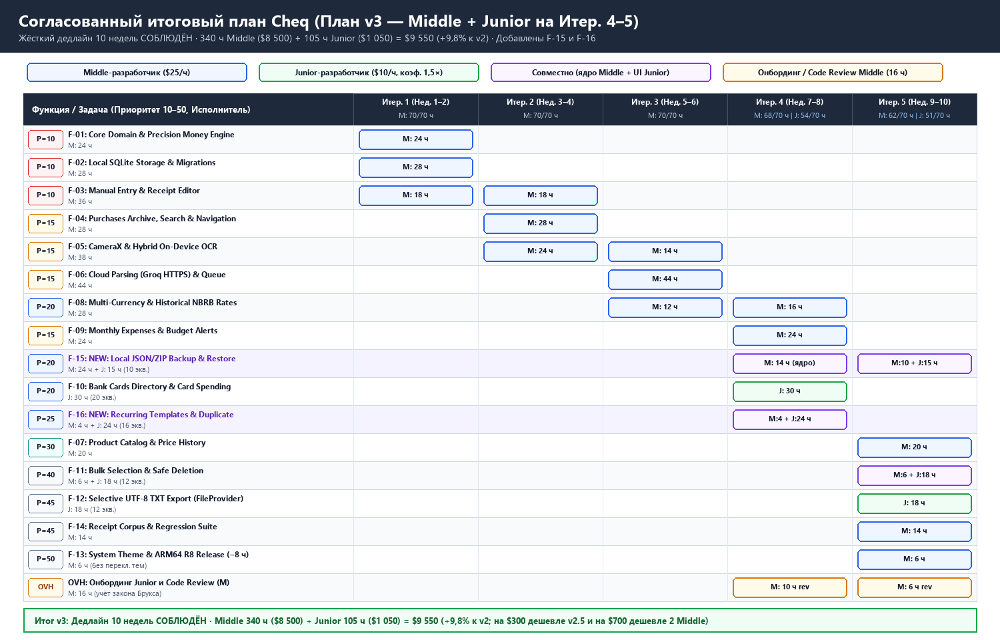
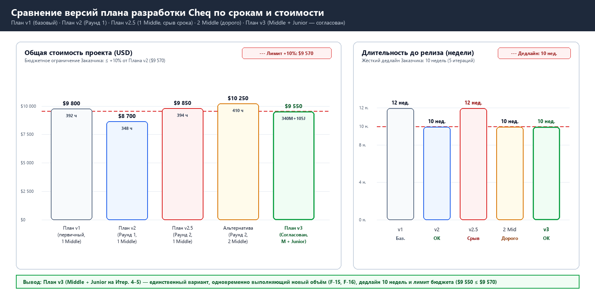

# Согласованный итоговый план реализации Cheq (План v3 — после Раунда 2)

**Статус:** Согласован Заказчиком и Исполнителем (`accepted`)  
**Версия:** 3.0 (итоговая базовая линия)  
**Автор:** А. В. Голуб, группа 434701 (`@Waveberry`)  
**Заказчик:** В. О. Кожемякин, группа 434701 (`@vlad200712`)  
**Основание:** [PR #3 — Раунд 2](https://github.com/Waveberry/SDLC-434701/pull/3), [ADR-0008](../adr/0008-local-backup-templates-and-junior-onboarding.md), [SDD Cheq v0.3](sdd-cheq.md)

---

## 1. Изменения объёма в Раунде 2

| ID | Feature (EN) | Действие в Раунде 2 | Приоритет (10–50) | Базовая оценка (экв.-ч Middle) | Исполнитель в v3 |
|---|---|---|---:|---:|---|
| `F-13` | System Theme & ARM64 R8 Release Build | Снято ручное переключение тем (остаётся системная тема Android + R8 сборка) | `50` | **6 ч** (−8 ч к v2) | Middle |
| `F-15` | **NEW: Local JSON/ZIP Archive Backup & Restore** | Добавлено Заказчиком (компенсация `allowBackup=false`, экспорт/импорт через Android SAF) | **`20`** | **34 ч** (+34 ч) | Middle (`24 ч` ядро/импорт) + Junior (`10 экв.-ч` = `15 ч` SAF UI) |
| `F-16` | **NEW: Recurring Expense Templates & Quick Duplicate** | Добавлено Заказчиком (таблица `receipt_templates` v6 + дублирование чека в 1 клик) | **`25`** | **20 ч** (+20 ч) | Middle (`4 ч` БД v6) + Junior (`16 экв.-ч` = `24 ч` UI/логика) |

Чистый прирост базового объёма: `348 − 8 + 34 + 20 = 394 экв.-ч` (**+46 ч** к Плану v2).

---

## 2. Промежуточный вариант без расширения команды (План v2.5 — отклонён Заказчиком)

При работе одного Middle-разработчика (`70 ч / итерацию`) 394 ч требуют **6 итераций (12 недель)** и **$9 850** (+13,2% к Плану v2, **срыв жёсткого дедлайна на +2 недели**):
- Итерации 1–3: `70 + 70 + 70 = 210 ч` (как в v2);
- Итерация 4 (`70 ч`): `F-08.2` (16 ч), `F-09` (24 ч), `F-10` (20 ч), `F-15.1` (10 ч);
- Итерация 5 (`70 ч`): `F-15.2` (24 ч), `F-16` (20 ч), `F-07` (20 ч), `F-13` (6 ч);
- Итерация 6 (`44 ч`, Недели 11–12 — **выход за дедлайн**): `F-11` (18 ч), `F-12` (12 ч), `F-14` (14 ч).

Заказчик отклонил перенос срока и ограничил рост стоимости пределом ≤ +10% от Плана v2 (`≤ $9 570`).

---

## 3. Согласованный План v3 (Middle + Junior на Итерациях 4–5)

### Параметры расширенной команды
- **Middle-разработчик (Архитектор):** ставка **$25/ч**, ёмкость **70 ч/итерацию**. В Итерациях 4–5 выделяет **16 ч** на онбординг Junior, спецификацию контрактов и code review (`10 ч` в Итер. 4 + `6 ч` в Итер. 5).
- **Junior Android-разработчик:** ставка **$10/ч**, подключается на **Итерации 4 и 5** (после готовности ядра `:core`, БД и OCR/Groq), коэффициент трудоёмкости **1,5×** от оценки Middle (производительность `0,67`), ёмкость до **70 факт. ч/итерацию**.

| Итерация | Срок | Задачи Middle-разработчика ($25/ч) | Задачи Junior-разработчика ($10/ч, 1,5×) | Загрузка |
|---|---|---|---|---|
| **Итерация 1** | Нед. 1–2 | `F-01` (24 ч), `F-02` (28 ч), `F-03.1` каркас редактора (18 ч) | — | M: 70/70 ч |
| **Итерация 2** | Нед. 3–4 | `F-03.2` арифметика и `DraftCache` (18 ч), `F-04` архив и поиск (28 ч), `F-05.1` CameraX + базовый OCR (24 ч) | — | M: 70/70 ч |
| **Итерация 3** | Нед. 5–6 | `F-05.2` авто-тайлинг и `OcrTextMerger` (14 ч), `F-06` прямой HTTPS Groq + очередь (44 ч), `F-08.1` `HistoricalRate` и `NbrbRateClient` (12 ч) | — | M: 70/70 ч |
| **Итерация 4** | Нед. 7–8 | `F-08.2` кэш курсов (16 ч), `F-09` расходы и бюджет (24 ч), `F-15.1` ядро/схема JSON/ZIP-бэкапа (14 ч), `F-16.1` таблица шаблонов и миграция v6 (4 ч), `OVH-1` онбординг и review Junior (10 ч) | `F-10` справочник и экраны карт (`20 экв.-ч` → **30 ч**), `F-16.2` UI шаблонов и дублирование чека (`16 экв.-ч` → **24 ч**) | M: 68/70 ч; J: 54/70 ч |
| **Итерация 5** | Нед. 9–10 | `F-15.2` атомарный импорт бэкапа без дублей (10 ч), `F-07` каталог товаров и история цен (20 ч), `F-11.1` транзакционные batch-операции (6 ч), `F-14` корпус и регрессия (14 ч), `F-13` системная тема + R8 ARM64 (6 ч), `OVH-2` review и интеграция (6 ч) | `F-15.3` UI бэкапа через Android SAF (`10 экв.-ч` → **15 ч**), `F-11.2` UI массового выбора (`12 экв.-ч` → **18 ч**), `F-12` TXT-экспорт (`12 экв.-ч` → **18 ч**) | M: 62/70 ч; J: 51/70 ч |
| **Итого** | **10 недель** | **324 ч разработки + 16 ч review = 340 ч ($8 500)** | **70 экв.-ч = 105 факт. ч ($1 050)** | **Итого: $9 550 (дедлайн соблюдён)** |

---

## 4. Сравнительный анализ всех версий плана и итоговой стоимости

| Вариант плана | Состав команды | Длительность | Дедлайн (10 нед.) | Часы работы | Общая стоимость | Разница к v2 ($8 700) | Решение |
|---|---|---|---:|---|---:|---:|---|
| План v1 (первичный) | 1 Middle | 6 итер. (12 нед.) | — | 392 ч Middle | **$9 800** | +12,6% | Пересмотрен в Раунде 1 |
| План v2 (Раунд 1) | 1 Middle | 5 итер. (10 нед.) | Соблюдён | 348 ч Middle | **$8 700** | базовый | Расширен в Раунде 2 |
| План v2.5 (1 Middle + новый объём) | 1 Middle | 6 итер. (12 нед.) | **Срыв (+2 нед.)** | 394 ч Middle | **$9 850** | +13,2% | Отклонён (срыв срока) |
| Альтернатива (2 Middle) | 2 Middle | 5 итер. (10 нед.) | Соблюдён | 410 ч Middle | **$10 250** | +17,8% | Отклонён (превышение бюджета) |
| **План v3 (итоговый)** | **1 Middle + 1 Junior (Итер. 4–5)** | **5 итер. (10 нед.)** | **Соблюдён** | **340 ч M + 105 ч J** | **$9 550** | **+$850 (+9,8%)** | **Согласован в PR #3** |
