# Описание дизайна программного обеспечения (SDD)

Для Android-приложения **Cheq**

Версия документа 0.4 · Целевая версия приложения 1.0 (`versionCode 11`, согласованный состав v3)

Подготовил: А. В. Голуб, группа 434701

БГУИР, ФКСиС, кафедра ЭВМ

23.11.2026

## Оглавление

<!-- TOC -->
* [1. Введение](#1-introduction)
  * [1.1 Назначение документа](#11-document-purpose)
  * [1.2 Область применения](#12-subject-scope)
  * [1.3 Определения, акронимы и сокращения](#13-definitions-acronyms-and-abbreviations)
  * [1.4 Ссылки](#14-references)
  * [1.5 Обзор документа](#15-document-overview)
* [2. Обзор дизайна](#2-design-overview)
  * [2.1 Задачи стейкхолдеров](#21-stakeholder-concerns)
  * [2.2 Выбранные точки зрения](#22-selected-viewpoints)
* [3. Проектные представления и системные требования](#3-design-views)
  * [3.1 Реестр системных требований (функциональные и нефункциональные)](#31-system-requirements)
  * [3.2 Приоритизация функционала (шкала 10–50) и первичный план](#32-feature-prioritization)
  * [3.3 Проектные представления (Design Views DV-01 — DV-12)](#33-views)
  * [3.4 Матрица трассируемости](#34-traceability-matrix)
  * [3.5 Модель динамического поведения системы (UML 2.5)](#35-uml-dynamic-behavior)
* [4. Решения (ADR)](#4-decisions)
* [5. Приложения](#5-appendixes)
<!-- TOC -->

## История изменений

| Автор | Дата | Причина изменений | Версия |
|---|---|---|---|
| А. В. Голуб | 21.11.2026 | Первичная версия SDD на основе SRS v1.2 и исходников Cheq 1.0: системные требования, 12 проектных представлений, ADR-0001..0007, приоритеты 10–50 и базовый план v1 | 0.1 |
| А. В. Голуб | 21.11.2026 | Итоги Раунда 1 с Заказчиком (`@vlad200712`, PR #3): отказ от Cloudflare Worker (`ADR-0004` → `accepted`), пересмотр приоритетов 10–50, оптимизация до 5 итераций / 10 недель ([План v2](plan-v2.md)) | 0.2 |
| А. В. Голуб | 21.11.2026 | Итоги Раунда 2 (PR #3): отказ от переключателя тем (`F-13`), добавлены `SYS-FUNC-015` (бэкап JSON/ZIP SAF) и `SYS-FUNC-016` (шаблоны покупок, миграция БД v6), привлечён Junior-разработчик на Итер. 4–5 (`ADR-0008`, [План v3](plan-v3.md)) | 0.3 |
| А. В. Голуб | 23.11.2026 | ЛР № 5: добавлена модель динамического поведения UML 2.5 (`uml/glossary.md`, `uml/supplementary-specifications.md`, `uml/use-case-specifications.md`, 6 диаграмм PlantUML), `ADR-0009` и реализация `F-15`/`F-16` (`BackupCodec`, `receiptbox.db` v6) | 0.4 |

---

## 1. Введение {#1-introduction}

### 1.1 Назначение документа {#11-document-purpose}

Настоящий документ Software Design Description (SDD) фиксирует системные требования, программную архитектуру, внутреннюю структуру модулей, схемы данных, контракты внешних интерфейсов, алгоритмы и ключевые архитектурные решения Android-приложения **Cheq**. Документ составлен в соответствии со стандартами IEEE 1016-2009 и ISO/IEC/IEEE 42010:2011 на основе согласованной спецификации требований [SRS Cheq v1.2](../srs/srs-cheq.md).

Целевая аудитория SDD: архитектор системы, разработчики (включая подключаемого Junior-разработчика), заказчик (в части обсуждения архитектурных ограничений, рисков и сроков), а также преподаватель-рецензент. Документ используется как руководство к реализации, основа для код-ревью и верификации, а также точка синхронизации при внесении изменений в план разработки.

### 1.2 Область применения {#12-subject-scope}

Проектируемая система — нативное Android-приложение **Cheq 1.0** (`applicationId = com.waveberry.cheq`, Android 8.0+ API 26–36, архитектура `arm64-v8a`, Java 17 / Android XML Views) для личного учёта купленных товаров, кассовых и электронных чеков, банковских квитанций, истории цен, мультивалютных расходов и месячного бюджета. Приложение работает автономно на одном устройстве одного владельца без учётных записей и собственного сервера хранения архива.

В область данного SDD входят два Gradle-модуля (`:core` — чистая Java 17 библиотека доменной логики, расчётов, парсеров и сетевых клиентов; `:app` — Android-приложение с UI, CameraX, гибридным OCR ML Kit + Tesseract, двумя SQLite БД и `FileProvider`), а также интеграции с внешними HTTPS-сервисами Groq API и API НБРБ. За границами базовой версии 0.1 (как и в SRS v1.2) находятся: проведение платежей и банковские API, учёт доходов и возвратов с отрицательными суммами, облачная синхронизация, совместный доступ, а также клиенты для iOS/Web/Desktop. Изменение границ возможно по итогам раундов согласования с заказчиком и фиксируется через обновление версии SDD и новые ADR.

### 1.3 Определения, акронимы и сокращения {#13-definitions-acronyms-and-abbreviations}

| Термин | Определение |
|---|---|
| ABI | Application Binary Interface — двоичный интерфейс целевой процессорной архитектуры Android (`arm64-v8a`) |
| ACID | Atomicity, Consistency, Isolation, Durability — свойства транзакций локальной БД SQLite |
| ADR | Architecture Decision Record — протокол значимого архитектурного решения в формате MADR 4.0 |
| API | Application Programming Interface — программный интерфейс взаимодействия между компонентами или внешними сервисами |
| CAS | Compare-And-Swap — атомарное условное обновление записи по номеру ревизии (`WHERE id=? AND revision=?`) |
| EXIF | Exchangeable Image File Format — метаданные изображения, включая тег ориентации снимка с камеры |
| FK | Foreign Key — внешний ключ ссылочной целостности в SQLite (`PRAGMA foreign_keys = ON`) |
| LLM | Large Language Model — большая языковая модель (`openai/gpt-oss-20b` в Groq API) |
| MADR | Markdown Architectural Decision Records — стандартный Markdown-шаблон записей ADR |
| Minor units | Целые сотые доли денежной суммы (`long`: `3,20 BYN = 320`), исключающие погрешность `float`/`double` |
| MVVM | Model-View-ViewModel — архитектурный паттерн разделения экрана (`Activity`) и состояния (`AndroidViewModel` + `LiveData`) |
| OCC | Optimistic Concurrency Control — оптимистичное управление конкурентным доступом через счётчик `revision` |
| OCR | Optical Character Recognition — локальное оптическое распознавание текста с изображения чека |
| R8 | Инструмент сжатия, оптимизации и удаления неиспользуемого байт-кода и ресурсов в Android Gradle Plugin |
| SDD | Software Design Description — описание дизайна и архитектуры ПО (IEEE 1016-2009) |
| SRS | Software Requirements Specification — спецификация требований к ПО (ISO/IEC/IEEE 29148:2018) |
| View | Проектное представление — экземпляр точки зрения (Viewpoint), описывающий конкретный аспект системы |
| Viewpoint | Точка зрения — соглашение о правилах и нотациях построения проектного представления (ISO/IEC/IEEE 42010) |
| WAL | Write-Ahead Logging — журнал предзаписи SQLite, позволяющий неблокирующее чтение параллельно с записью |

### 1.4 Ссылки {#14-references}

| № | Документ / Источник | Версия / Дата | Расположение | Тип |
|---|---|---|---|---|
| 1 | Задание лабораторной работы № 4 «Разработка и документирование системных требований» | БГУИР, 2026 | Материалы курса ЖЦРПО | Нормативная |
| 2 | Спецификация требований к ПО (SRS) для Android-приложения Cheq | v1.2, 30.10.2026 | [srs/srs-cheq.md](../srs/srs-cheq.md) | Нормативная |
| 3 | Шаблон SDD (`sdd-template.md`) и шаблоны ADR (`adr-template.md`) | БГУИР, 2026 | [sdd/sdd-template.md](sdd-template.md), [adr/adr-template.md](../adr/adr-template.md) | Нормативная |
| 4 | IEEE 1016-2009 & ISO/IEC/IEEE 42010:2011 (сводка стандартов курса) | 2026 | [docs/standards.md](../docs/standards.md) | Нормативная |
| 5 | Модель качества ПО ISO/IEC 25010:2011 и трассируемость | 2026 | [docs/quality-attributes.md](../docs/quality-attributes.md), [docs/traceability.md](../docs/traceability.md) | Справочная |
| 6 | Исходный код проекта Cheq 1.0 (`:app`, `:core`, `scripts/`) | v1.0 (`versionCode 11`) | Локальный проект `Cheq` (`com.waveberry.cheq`) | Справочная |
| 7 | Документация официального API курсов валют НБРБ | Актуальная | https://www.nbrb.by/apihelp/exrates | Справочная |
| 8 | Документация Groq API (Structured Outputs / JSON Schema) | Актуальная | https://console.groq.com/docs/structured-outputs | Справочная |
| 9 | Задание лабораторной работы № 5 «Моделирование динамического поведения системы на языке UML» | БГУИР, 2026 | Материалы курса ЖЦРПО | Нормативная |
| 10 | Глоссарий, дополнительные спецификации и потоки событий прецедентов Cheq | v1.1, 23.11.2026 | [uml/glossary.md](../uml/glossary.md), [uml/supplementary-specifications.md](../uml/supplementary-specifications.md), [uml/use-case-specifications.md](../uml/use-case-specifications.md) | Нормативная |

### 1.5 Обзор документа {#15-document-overview}

Раздел 2 определяет стейкхолдеров, их интересы (Concerns) и выбранный набор точек зрения (Viewpoints) по стандарту ISO/IEC/IEEE 42010. Раздел 3 содержит реестр функциональных и нефункциональных системных требований (`SYS-FUNC-*`, `SYS-NFR-*`), таблицу приоритизации функционала (10–50), двенадцать детальных проектных представлений (`DV-01` — `DV-12`), сквозную матрицу трассируемости и раздел `3.5` с моделью динамического поведения на языке UML 2.5. Раздел 4 сводит принятые архитектурные решения (`ADR-0001` — `ADR-0009`), вынесенные в отдельные файлы каталога `adr/`. Раздел 5 ссылается на итерационный план реализации, UML-артефакты и тестовое покрытие.

Документ поддерживается в актуальном состоянии в ветках `lab4-cheq-design` и `lab5-uml-modeling`: каждое согласованное изменение объёма, приоритетов, архитектуры или UML-моделей отражается в таблице истории изменений, затрагиваемых `DV-*` и отдельном ADR.

---

## 2. Обзор дизайна {#2-design-overview}

### 2.1 Задачи стейкхолдеров {#21-stakeholder-concerns}

| Стейкхолдер | Ключевые задачи и интересы (Concerns) | Адресующие точки зрения (Viewpoints) |
|---|---|---|
| **Владелец личного архива (конечный пользователь)** | Быстрый ввод чека с фото или вручную, точность сумм и исторических курсов, работа без сети, отсутствие потери черновиков, приватность фото и карточных данных | Context, Information, Interaction, State Dynamics, Resources |
| **Заказчик** | Прозрачность сроков и стоимости каждой функции, предсказуемый итерационный выпуск, возможность пересматривать приоритеты и минимизировать риски срыва дедлайна | Context, Composition, Dependency, Deployment, План v1 |
| **Архитектор / Middle-разработчик** | Низкая связанность, чистое тестируемое ядро `:core`, защита от гонок потоков и дублей сохранения, управляемость миграций SQLite, стабильность интеграций с Groq и НБРБ | Composition, Logical, Dependency, Information, Interface, Interaction, Algorithm, State Dynamics, Concurrency, Patterns, Resources |
| **Junior-разработчик (потенциальное расширение команды)** | Чёткие границы пакетов и интерфейсов, изоляция сложных транзакционных и многопоточных участков, воспроизводимая CLI-сборка и быстрые автотесты | Composition, Logical, Interface, Patterns, Deployment |
| **Преподаватель / рецензент** | Соответствие стандартам IEEE 1016 / ISO 42010 / ISO 25010 / MADR 4.0, полная сквозная трассируемость `BG → REQ → SYS → DV → ADR → Code/Test`, обоснованность решений | Все выбранные точки зрения + Матрица трассируемости + ADR |

### 2.2 Выбранные точки зрения {#22-selected-viewpoints}

Из 15 канонических точек зрения IEEE 1016 / ISO 42010 для Cheq отобраны **12 точек зрения**, непосредственно адресующих задачи стейкхолдеров. Точки зрения **Physical** (серверные стойки/облачная сеть) и отдельная **Structure** (внутренние порты аппаратных узлов) не выделяются самостоятельно, поскольку Cheq не имеет собственной серверной инфраструктуры, а внутренняя структура пакетов полностью раскрыта в **Composition** и **Logical**.

| № | Точка зрения (Viewpoint) | ID представления | Используемые нотации | Адресуемые интересы |
|---|---|---|---|---|
| 1 | **Context** (Контекст) | `DV-01` | C4 Context Diagram | Границы приложения, внешние сервисы Groq и НБРБ, системные средства Android |
| 2 | **Composition** (Композиция) | `DV-02` | UML Component / Package Diagram | Декомпозиция на модули `:app` и `:core`, распределение ответственности пакетов |
| 3 | **Logical** (Логическое представление) | `DV-03` | UML Class Diagram | Доменные типы, репозитории, `ViewModel`, сервисы и интерфейсы |
| 4 | **Dependency** (Зависимости) | `DV-04` | Граф зависимостей модулей и библиотек | Однонаправленная зависимость `:app → :core`, версии библиотек, анализ влияния изменений |
| 5 | **Information** (Информация) | `DV-05` | ER-диаграмма SQLite + файловая схема | Схема `receiptbox.db` v6, `pending_receipts.db` v1, миграции, ссылочная целостность |
| 6 | **Interface** (Интерфейс) | `DV-06` | Спецификации REST/JSON Schema и Java-интерфейсов | Контракты Groq API, НБРБ ExRates API, `FileProvider` TXT, внутренние интерфейсы |
| 7 | **Interaction** (Взаимодействие) | `DV-07` | UML Sequence Diagram | Сквозной сценарий импорта чека, офлайн-ветка и обработка ошибок сервиса |
| 8 | **Algorithm** (Алгоритм) | `DV-08` | Формулы и алгоритмические спецификации | Слияние `OcrTextMerger`, полосовой тайлинг, кросс-курс `HistoricalRate`, `ReceiptArithmetic` |
| 9 | **State Dynamics** (Динамика состояний) | `DV-09` | UML State Machine Diagram | Жизненный цикл элемента очереди `waiting / processing / ready / error`, OCC `revision` |
| 10 | **Concurrency** (Параллелизм) | `DV-10` | Таблица потоков и примитивов синхронизации | Разделение UI/фоновых исполнителей, watchdog-таймеры, защита от гонок и дублей |
| 11 | **Patterns** (Паттерны) | `DV-11` | Архитектурный реестр паттернов | Повторно используемые проектные решения (MVVM, Repository, OCC, Idempotent Consumer и др.) |
| 12 | **Deployment & Resources** (Развёртывание и ресурсы) | `DV-12` | Схема развёртывания + таблица лимитов ресурсов | Сборка ARM64 R8 APK, песочница Android, лимиты памяти декодирования, таймауты и кэш |

---

## 3. Проектные представления и системные требования {#3-design-views}

### 3.1 Реестр системных требований (функциональные и нефункциональные) {#31-system-requirements}

Системные требования конкретизируют бизнес- и пользовательские требования из [SRS v1.2](../srs/srs-cheq.md) до уровня инженерных обязательств модулей `:core` и `:app`.

#### 3.1.1 Функциональные системные требования (`SYS-FUNC-*`)

| ID | Название | Инженерная спецификация системного требования | Связанные `REQ-*` | Модуль / Класс |
|---|---|---|---|---|
| `SYS-FUNC-001` | Доменная модель и точная арифметика | Модуль `:core` должен представлять суммы в `long` (сотые доли, `0..100 000 000 000`), количества в `long` (тысячные доли, `1..1 000 000 000`), валидировать ≤ 200 позиций, ≤ 24 000 символов текста, даты с `2000-01-01` до `today+1y`, 6 валют и 11 категорий, а также проверять `|unit*qty - line| ≤ 1` и `|sum(lines) - total| ≤ 1` без автоматического выравнивания | `REQ-FUNC-001`, `REQ-FUNC-004`, `REQ-REUSE-001` | `:core`: `ReceiptDraft`, `ReceiptItem`, `Money`, `ReceiptArithmetic` |
| `SYS-FUNC-002` | Персистентное хранилище и миграции | `ReceiptStore` должен управлять SQLite БД `receiptbox.db` (v6, WAL, `PRAGMA foreign_keys=ON`), выполнять запись покупки с позициями и маркером `completed_pending` в единой ACID-транзакции и поддерживать миграции с версий 1–5 до 6 без потери данных | `REQ-REL-001`, `REQ-REL-003`, `REQ-SEC-001` | `:app/data`: `ReceiptStore`, `ReceiptPhotos` |
| `SYS-FUNC-003` | Редактор чека и сохранение черновика | `EditorActivity` + `EditorModel` должны обеспечивать ручной ввод, правку всех полей чека, показ предупреждений `ReceiptArithmetic.discrepancies()`, поддержку чеков без позиций (`totalMinor > 0`, `items = []`), сохранность при повороте экрана (`DraftCache`) и запрет автосохранения без действия пользователя | `REQ-INT-002`, `REQ-FUNC-001`, `REQ-FUNC-003..005`, `REQ-FUNC-021`, `REQ-ML-002` | `:app/ui`: `EditorActivity`, `EditorModel`, `EditorForm`, `DraftCache` |
| `SYS-FUNC-004` | Навигация, архив и поиск | `MainActivity` должна предоставлять 4 раздела нижней навигации («Покупки», «Товары», «Расходы», «Настройки»), переключение карточек/списка, фильтрацию по магазину/товару/дате (`searchText`), сортировку и сохранение выбранных настроек в `AppPreferences` | `REQ-INT-001`, `REQ-FUNC-006`, `REQ-FUNC-007` | `:app/ui`: `MainActivity`, `ReceiptBrowser`, `AppPreferences` |
| `SYS-FUNC-005` | Камера и гибридный локальный OCR | `CameraActivity` (CameraX) и системный выбор фото должны передавать URI в `OcrEngine`, который корректирует EXIF-ориентацию, режет длинные чеки на полосы (`OcrPreparation.bands`, ≤ 24 полосы), запускает ML Kit Latin + Tesseract `rus+eng` с фолбэком контраста и объединяет строки в `OcrTextMerger.merge()` | `REQ-INT-003`, `REQ-FUNC-002`, `REQ-ML-001`, `REQ-ML-003` | `:app/scan`: `CameraActivity`, `OcrEngine`, `OcrPreparation`; `:core`: `OcrTextMerger` |
| `SYS-FUNC-006` | Облачный разбор Groq и сохраняемая очередь | `RecognitionQueue` должен сохранять импорт в `pending_receipts.db`, обрабатывать фото и текст в фоне, отправлять только OCR-текст, дату и валюту в `GroqConnection` (`openai/gpt-oss-20b`, `strict json_schema`), прогонять ответ через `ReceiptExtraction.reconcile()` и `verifyCardLastFour()`, автоматически возобновляться по `NetworkCallback` и защищать ручные правки через CAS по `revision` | `REQ-INT-005`, `REQ-FUNC-020`, `REQ-ML-001..002`, `REQ-REL-002`, `REQ-OBS-001` | `:app/ui`: `RecognitionQueue`; `:app/data`: `PendingReceiptStore`; `:app/cloud`: `GroqClient`; `:core`: `GroqReceiptApi`, `GroqConnection`, `ReceiptExtraction` |
| `SYS-FUNC-007` | Каталог товаров и история цен | `ReceiptStore.products()` и `history()` должны группировать строки по `(product_key, currency)`, рассчитывать последнюю/мин/макс цену в исходной валюте и поддерживать массовое обновление категории по `product_key` | `REQ-FUNC-008` | `:app/data`: `ReceiptStore`; `:app/ui`: `ProductBrowser` |
| `SYS-FUNC-008` | Мультивалютность и исторические курсы НБРБ | `NbrbRateClient` и `HistoricalRateRepository` должны загружать официальные курсы на дату покупки (с фолбэком `?parammode=2`), кэшировать их в `exchange_rates`, выполнять кросс-пересчёт через `BYN` с учётом `scale` и деноминации 2016 г. с однократным округлением `HALF_UP` и маркировать `missingRateCount > 0` при отсутствии курса | `REQ-INT-004`, `REQ-FUNC-009..011`, `REQ-AVAIL-001` | `:core`: `HistoricalRate`, `NbrbRateClient`; `:app/data`: `HistoricalRateRepository` |
| `SYS-FUNC-009` | Месячная аналитика и бюджет | `ReceiptStore.statsConverted()` и `BudgetProgress.of()` должны рассчитывать сводку месяца по категориям (с явной строкой «Корректировка чека» при расхождении с итогом), хранить лимит по `(month, currency)`, классифицировать состояния `<80%` (`NORMAL`), `80–100%` (`NEAR_LIMIT`), `>100%` (`OVER_LIMIT`) и откладывать итоговый алерт при `missingRateCount > 0` | `REQ-FUNC-012`, `REQ-FUNC-013` | `:core`: `BudgetProgress`; `:app/data`: `ReceiptStore`; `:app/ui`: `MainActivity` |
| `SYS-FUNC-010` | Справочник карт и расходы по картам | `CardManager` и `ReceiptStore` должны поддерживать CRUD карт (`label` 1..80 символов, `last_four` ровно 4 цифры), снимать связь `ON DELETE SET NULL` при удалении, предлагать однозначное совпадение карты списания без перезаписи явного выбора пользователя и агрегировать `cardSpending()` по картам и группе «Без карты» | `REQ-FUNC-014..016`, `REQ-SEC-002` | `:app/ui`: `CardManager`; `:app/data`: `ReceiptStore`; `:core`: `BankReceiptParser` |
| `SYS-FUNC-011` | Массовый выбор и безопасное удаление | `SelectionModel` должен поддерживать множественный выбор с учётом активного фильтра поиска и поворота экрана; `ReceiptStore.deleteReceipts()` должен удалять выбранные записи пакетами по ≤ 400 ID в транзакции и удалять файл фото только при отсутствии ссылок в `receipts`, `pending` и `DraftCache` | `REQ-FUNC-017`, `REQ-FUNC-018` | `:app/ui`: `SelectionModel`; `:app/data`: `ReceiptStore` |
| `SYS-FUNC-012` | Выборочный UTF-8 TXT-экспорт | `SelectionSharing` должен формировать временный UTF-8 TXT в `cache/shares/` только из выбранных покупок или истории товаров (исключая `rawText`, фото и карточные поля), выдавать временный URI через `FileProvider` и удалять старые файлы экспорта старше 24 ч | `REQ-FUNC-019`, `REQ-SEC-001`, `REQ-SEC-002` | `:app/ui`: `SelectionSharing` |
| `SYS-FUNC-013` | Системная тема и сборка поставки | Приложение должно следовать системной теме Android (ручной переключатель тем снят в Раунде 2), собираться Gradle Wrapper на JDK 17 в ARM64 APK (`arm64-v8a`, `minSdk 26`, R8 release) без обязательного `GroqApi.key` и содержать актуальный `THIRD_PARTY.md` | `REQ-FUNC-021`, `REQ-INST-001`, `REQ-BUILD-001`, `REQ-DIST-001`, `REQ-COMP-001`, `REQ-PORT-001` | `app/build.gradle`, `scripts/build.ps1`, `AppPreferences`, `THIRD_PARTY.md` |
| `SYS-FUNC-014` | Автоматическая регрессия и корпус чеков | Проект должен включать модульные тесты `:core` (JUnit), интеграционные UI/БД тесты `:app` (Robolectric) и CLI-прогон синтетического корпуса `scripts/verify-receipt-corpus.ps1` для проверки обновлений модели, парсеров и бэкапа | `REQ-ML-003`, `REQ-POC-001`, `REQ-MAINT-001` | `core/src/test`, `app/src/test`, `scripts/verify-receipt-corpus.ps1` |
| `SYS-FUNC-015` | Локальное резервное копирование и восстановление архива (CR-01, Раунд 2) | Система должна экспортировать и атомарно восстанавливать версионируемый JSON/ZIP-архив (покупки, позиции, карты, бюджеты, кэш курсов, шаблоны) через системный Android SAF (`ACTION_CREATE_DOCUMENT`/`ACTION_OPEN_DOCUMENT`) с пре-транзакционной валидацией схемы (`schemaVersion=6`, ≤ 10 МБ) и защитой от дублей при `allowBackup=false` | `CR-01` (PR #3), `REQ-SEC-001`, `REQ-REL-001` | `:core`: `BackupSnapshot`, `BackupCodec`; `:app/data`: `ReceiptStore` (v6); `:app/ui`: `SettingsPanel`, `MainActivity` |
| `SYS-FUNC-016` | Шаблоны регулярных покупок и дублирование чека (CR-02, Раунд 2) | Система должна хранить пользовательские шаблоны чеков в таблице `receipt_templates` (`receiptbox.db` v6) и предоставлять сохранение чека как шаблона, создание покупки из шаблона и дублирование существующего чека в 1 клик с подстановкой текущей даты | `CR-02` (PR #3), `REQ-FUNC-001`, `REQ-FUNC-003` | `:app/data`: `ReceiptStore` (`receipt_templates`, v6); `:app/ui`: `EditorActivity`, `EditorModel`, `MainActivity` |

#### 3.1.2 Нефункциональные системные требования (`SYS-NFR-*`, ISO/IEC 25010)

| ID | Категория ISO 25010 | Количественное / проверяемое требование | Связанные `REQ-*` |
|---|---|---|---|
| `SYS-NFR-001` | Performance Efficiency (Time behaviour) | 95-й перцентиль времени открытия и поиска в локальном архиве из 1000 чеков на устройстве с 4 ГБ ОЗУ ≤ **2,0 с** без сетевых обращений (за счёт WAL и индексов `receipts_currency_date`, `items_product_receipt`, `receipts_purchase_date`, `receipts_card`) | `REQ-PERF-001` |
| `SYS-NFR-002` | Performance Efficiency (Responsiveness & Resources) | 0 блокирующих операций OCR, HTTP и транзакций сохранения на главном UI-потоке; декодирование фото ограничено `12 000 000` пикс., тайлинг ≤ `24` полос, размер HTTP-ответа ≤ `256 КБ`, жёсткие дедлайны: OCR `120 с` (Tesseract `90 с`, ML Kit `25 с`/полоса), Groq `55 с`, НБРБ `12 с` | `REQ-PERF-002` |
| `SYS-NFR-003` | Security (Confidentiality & Integrity) | `allowBackup="false"`, `cleartextTrafficPermitted="false"`, `setInstanceFollowRedirects(false)`, запрет хранения `PAN`/`CVV`/срока действия карты на уровне схемы SQLite (`CHECK`), валидация имён фото `[A-Za-z0-9_-]+\.jpg`, отсутствие секретов и текстов чеков в диагностических логах | `REQ-SEC-001..003`, `REQ-DIST-001` |
| `SYS-NFR-004` | Reliability (Fault tolerance & Recoverability) | Атомарность записи покупок (`beginTransaction/setTransactionSuccessful`), идемпотентность `savePending` через `completed_pending`, восстановление прерванных записей `processing → waiting` при старте (`PendingReceiptStore.recover()`), экспоненциальный backoff ошибок `min(60 с, 2 с << (failures-1))` | `REQ-REL-001..003`, `REQ-FUNC-020` |
| `SYS-NFR-005` | Reliability (Availability / Offline-first) | 100% доступность ручного ввода, архива, истории цен, локального OCR и аналитики по кэшированным курсам без интернета; при отсутствии ключа или отказе Groq ручной учёт и сохранённая очередь не блокируются | `REQ-AVAIL-001`, `REQ-COST-001` |
| `SYS-NFR-006` | Maintainability (Modularity & Testability) | Строгое разделение `:app → :core` без циклических зависимостей; 100% независимость `:core` от `android.*`; покрытие критичных правил автоматическими тестовыми наборами (`19 :core` [149 тестов] + `31 :app`, вкл. бэкап и миграцию v6) | `REQ-REUSE-001`, `REQ-MAINT-001` |
| `SYS-NFR-007` | Maintainability (Analysability / Observability) | Явное различение в UI шести состояний: локальный OCR, ожидание сети, обработка Groq, готовность к проверке, классифицированная ошибка сервиса (`GroqErrors`: 401/403/429/400/timeout/SSL/JSON/truncated), ожидание курса НБРБ | `REQ-OBS-001`, `REQ-REL-002` |
| `SYS-NFR-008` | Compatibility & AI Safety | Резервирование OCR-движков (отказ ML Kit или Tesseract сохраняет результат второго); независимый пост-контроль LLM-вывода (`ReceiptExtraction.reconcile`, `ReceiptArithmetic`, `verifyCardLastFour`) и обязательное подтверждение человеком | `REQ-ML-001..003` |
| `SYS-NFR-009` | Portability (Installability) | Поддержка Android 8.0–16 (API 26–36), `arm64-v8a`, необязательность аппаратной камеры (`required="false"`), повторяемая сборка Gradle 8.13 + JDK 17 | `REQ-INST-001`, `REQ-BUILD-001`, `REQ-PORT-001` |
| `SYS-NFR-010` | Compatibility (Compliance) | Полный учёт лицензий сторонних компонентов (`THIRD_PARTY.md`, `assets/licenses/Roboto-OFL.txt`, `Lucide-LICENSE.txt`) | `REQ-COMP-001` |

---

### 3.2 Приоритизация функционала (шкала 10–50) и эволюция планов (v1 → v2 → v3) {#32-feature-prioritization}

В соответствии с заданием лабораторной работы № 4 архитектор ранжировал функционал по шкале от **10** (наивысший приоритет) до **50** (минимальный приоритет). В ходе двух раундов согласования с Заказчиком (`@vlad200712`, [PR #3](https://github.com/Waveberry/SDLC-434701/pull/3)) приоритеты, состав и команда были скорректированы: подробные расписания вынесены в [План v1](plan-v1.md), [План v2](plan-v2.md) и итоговый [План v3](plan-v3.md).

| ID | Feature (EN) | v1 Prio / ч | v2 Prio / ч | **v3 Prio / экв.-ч** | Исполнитель в v3 |
|---|---|---:|---:|---:|---|
| `F-01` | Core Domain & Precision Money Engine | 10 / 24 ч | 10 / 24 ч | **10 / 24 ч** | Middle |
| `F-02` | Local SQLite Storage & Schema Migrations | 10 / 28 ч | 10 / 28 ч | **10 / 28 ч** | Middle |
| `F-03` | Manual Entry & Receipt Editor | 10 / 36 ч | 10 / 36 ч | **10 / 36 ч** | Middle |
| `F-04` | Purchases Archive, Search & Navigation | 15 / 28 ч | 15 / 28 ч | **15 / 28 ч** | Middle |
| `F-05` | CameraX Capture & Hybrid On-Device OCR | 15 / 48 ч | 15 / 38 ч | **15 / 38 ч** | Middle |
| `F-06` | Cloud Receipt Parsing (Groq) & Persistent Queue | 15 / 60 ч | 15 / 44 ч | **15 / 44 ч** | Middle |
| `F-07` | Product Catalog, Price History & Categories | 20 / 20 ч | 30 / 20 ч | **30 / 20 ч** | Middle |
| `F-08` | Multi-Currency & Historical NBRB Exchange Rates | 20 / 34 ч | 20 / 28 ч | **20 / 28 ч** | Middle |
| `F-09` | Monthly Expenses Analytics & Budget Alerts | 25 / 24 ч | 15 / 24 ч | **15 / 24 ч** | Middle |
| `F-10` | Bank Cards Directory & Card Spending Breakdown | 30 / 20 ч | 20 / 20 ч | **20 / 20 ч** | Junior (30 факт. ч) |
| `F-11` | Bulk Selection & Safe Deletion | 35 / 18 ч | 40 / 18 ч | **40 / 18 ч** | Middle (6 ч) + Junior (18 факт. ч) |
| `F-12` | Selective UTF-8 TXT Export via FileProvider | 40 / 12 ч | 45 / 12 ч | **45 / 12 ч** | Junior (18 факт. ч) |
| `F-13` | System Theme & ARM64 R8 Release Build | 45 / 22 ч | 45 / 14 ч | **50 / 6 ч** | Middle (снят перекл. тем) |
| `F-14` | Synthetic Receipt Corpus & Regression Test Suite | 50 / 18 ч | 50 / 14 ч | **45 / 14 ч** | Middle |
| `F-15` | **NEW (R2): Local JSON/ZIP Archive Backup & Restore** | — | — | **20 / 34 ч** | Middle (24 ч) + Junior (15 факт. ч) |
| `F-16` | **NEW (R2): Recurring Expense Templates & Quick Duplicate** | — | — | **25 / 20 ч** | Middle (4 ч) + Junior (24 факт. ч) |
| **Итого** | **Срок / Стоимость (+16 ч review Middle в v3)** | **392 ч / 12 нед. / $9 800** | **348 ч / 10 нед. / $8 700** | **394 экв.-ч / 10 нед. / $9 550** | **340 ч M ($8 500) + 105 ч J ($1 050)** |

---

### 3.3 Проектные представления (Design Views DV-01 — DV-12) {#33-views}

#### `[DV-01]` Системный контекст {#dv-01}
- **ID**: `DV-01-context`
- **Title**: Системный контекст и внешние границы Android-приложения Cheq
- **Viewpoint**: Context
- **Representation**:

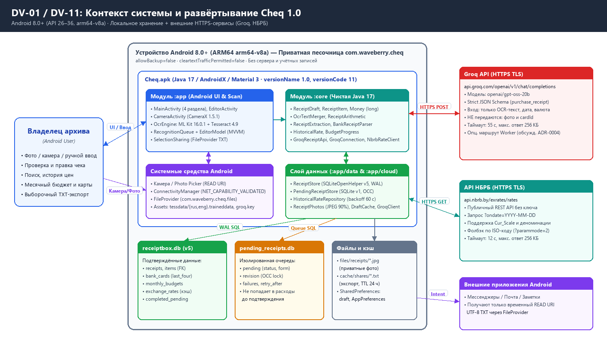

Cheq работает как автономный локальный клиент внутри приватной песочницы Android (`com.waveberry.cheq`). Внешними акторами и системами выступают:
1. **Владелец архива** — вводит чеки вручную, фотографирует или выбирает изображения, проверяет распознанные позиции, ищет покупки, задаёт бюджеты и карты.
2. **Системные средства Android** — CameraX / Photo Picker (поставка URI снимка), `ConnectivityManager` (подтверждённая сеть `NET_CAPABILITY_VALIDATED`), `FileProvider` (временная выдача TXT внешним приложениям).
3. **Groq API (HTTPS TLS)** — облачный сервис разбора очищенного OCR-текста моделью `openai/gpt-oss-20b` в строгую JSON-схему (без изображений и локальных `cardId`).
4. **API НБРБ (HTTPS TLS)** — публичный источник исторических официальных курсов валют на дату покупки без авторизации.

- **More Information**: Реализует `REQ-INT-001..005`, `REQ-AVAIL-001`, `REQ-SEC-001`, `REQ-SEC-003` (`SYS-FUNC-004..006`, `SYS-FUNC-008`, `SYS-NFR-003`, `SYS-NFR-005`). Связанные решения: [ADR-0004](../adr/0004-groq-cloud-parsing-route-worker-vs-direct-https.md), [ADR-0006](../adr/0006-card-data-minimization-and-local-privacy.md).

---

#### `[DV-02]` Композиция модулей и пакетов {#dv-02}
- **ID**: `DV-02-composition`
- **Title**: Модульная и пакетная композиция проекта Cheq (`:app` и `:core`)
- **Viewpoint**: Composition
- **Representation**:

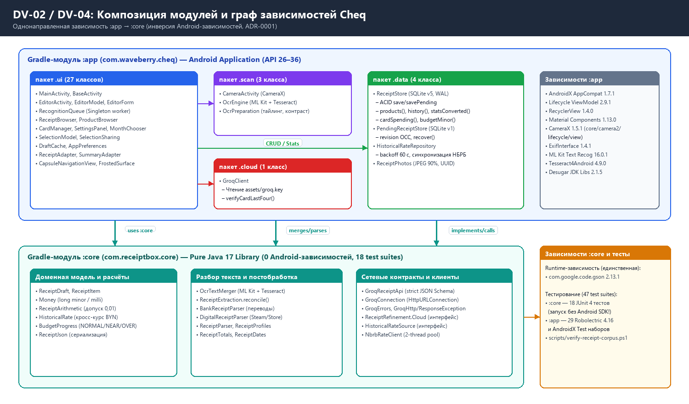

Система декомпозирована на два Gradle-модуля с однонаправленной зависимостью `:app → :core`:
- **`:core` (`com.receiptbox.core`, 25 классов)** — доменная модель (`ReceiptDraft`, `ReceiptItem`, `BackupSnapshot`), точные вычисления (`Money`, `ReceiptArithmetic`, `HistoricalRate`, `BudgetProgress`), разбор и верификация текста (`OcrTextMerger`, `ReceiptExtraction`, `BankReceiptParser`, `DigitalReceiptParser`, `ReceiptParser`, `ReceiptProfiles`, `ReceiptTotals`, `ReceiptDates`, `ReceiptJson`, `BackupCodec`), сетевые клиенты и контракты (`GroqReceiptApi`, `GroqConnection`, `GroqErrors`, `NbrbRateClient`, интерфейсы `HistoricalRateSource` и `ReceiptRefinement.Cloud`).
- **`:app` (`com.waveberry.cheq`, 35 классов)** — 4 прикладных пакета:
  - `.ui` (27 классов): активности (`MainActivity`, `EditorActivity`, `BaseActivity`), `EditorModel`, `RecognitionQueue`, браузеры (`ReceiptBrowser`, `ProductBrowser`), справочник карт (`CardManager`), настройки (`SettingsPanel`, `AppPreferences`), массовый выбор и экспорт (`SelectionModel`, `SelectionSharing`), `DraftCache`, адаптеры и UI-компоненты (`CapsuleNavigationView`, `FrostedSurface`, `MonthChooser`).
  - `.scan` (3 класса): `CameraActivity`, `OcrEngine`, `OcrPreparation`.
  - `.data` (4 класса): `ReceiptStore`, `PendingReceiptStore`, `HistoricalRateRepository`, `ReceiptPhotos`.
  - `.cloud` (1 класс): `GroqClient`.

- **More Information**: Реализует `REQ-REUSE-001`, `REQ-MAINT-001` (`SYS-FUNC-001`, `SYS-NFR-006`). Связанное решение: [ADR-0001](../adr/0001-separate-pure-java-core-module.md).

---

#### `[DV-03]` Логическое представление (ключевые классы) {#dv-03}
- **ID**: `DV-03-logical`
- **Title**: Статическая структура ключевых классов и интерфейсов Cheq
- **Viewpoint**: Logical
- **Representation**:

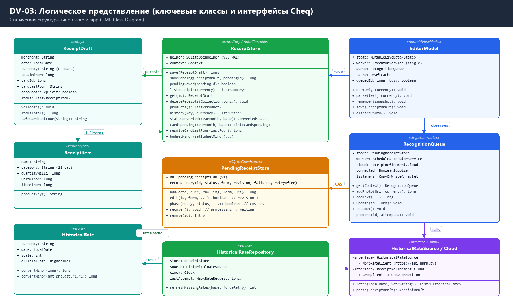

- `ReceiptDraft` и `ReceiptItem` — центральные доменные объекты; `ReceiptDraft.validate()` гарантирует инварианты до любой записи в SQLite.
- `ReceiptStore` реализует `AutoCloseable` и инкапсулирует всю работу с `receiptbox.db`, возвращая неизменяемые Java `record`-проекции (`Summary`, `Product`, `Price`, `Stats`, `ConvertedStats`, `Card`, `CardSpending`, `RateRequest`).
- `PendingReceiptStore` инкапсулирует `pending_receipts.db` и предоставляет синхронизированные операции с `Entry` (включая `revision` для CAS).
- `EditorModel` (`AndroidViewModel`) переживает поворот экрана, держит `MutableLiveData<State>`, слушает `RecognitionQueue` и выполняет сохранение на собственном однопоточном `ExecutorService`.
- `HistoricalRateRepository` зависит от интерфейса `HistoricalRateSource` (в продакшене `NbrbRateClient`, в тестах — заглушка), а `RecognitionQueue` — от `ReceiptRefinement.Cloud` (в продакшене `GroqClient`), что обеспечивает подмену внешних сервисов в 47 автотестах.

- **More Information**: Реализует `REQ-FUNC-001..021`, `REQ-REUSE-001` (`SYS-FUNC-001..012`, `SYS-NFR-006`). Связанные решения: [ADR-0001](../adr/0001-separate-pure-java-core-module.md), [ADR-0002](../adr/0002-dual-sqlite-databases-with-wal-and-idempotent-save.md).

---

#### `[DV-04]` Граф зависимостей {#dv-04}
- **ID**: `DV-04-dependency`
- **Title**: Зависимости модулей, сторонних библиотек и тестовых сред
- **Viewpoint**: Dependency
- **Representation**:

Граф зависимостей проиллюстрирован на диаграмме [DV-02 / DV-04](diagrams/02-component-composition.png). Ключевые правила управления зависимостями:

| Модуль | Зависимость | Версия | Назначение | Лицензия |
|---|---|---|---|---|
| `:core` | `com.google.code.gson:gson` | `2.13.1` | Кодирование/декодирование JSON (Groq, НБРБ, `EditorForm`) | Apache-2.0 |
| `:app` | `project(':core')` | local | Вся расчётная и парсерная логика | — |
| `:app` | `androidx.camera:camera-{core,camera2,lifecycle,view}` | `1.5.1` | Захват изображений чеков с камеры | Apache-2.0 |
| `:app` | `com.google.mlkit:text-recognition` | `16.0.1` | Встроенный офлайн OCR (латиница и цифры) | Google SDK Terms |
| `:app` | `cz.adaptech.tesseract4android:tesseract4android` | `4.9.0` | Встроенный офлайн OCR LSTM (`rus+eng`) | Apache-2.0 |
| `:app` | `androidx.appcompat`, `activity`, `fragment`, `lifecycle`, `recyclerview`, `exifinterface`, `material` | `1.7.1`..`2.9.1` | UI, `ViewModel`, EXIF-ориентация, Material 3 | Apache-2.0 |
| `:app` | `com.android.tools:desugar_jdk_libs` | `2.1.5` | Поддержка `java.time.*` на Android API 26+ | GPL-2.0 w/ CE |
| Test | `junit:junit` (`4.13.2`), `org.robolectric:robolectric` (`4.16`), `androidx.test:core` (`1.6.1`) | pinned | 19 JVM-наборов `:core` (149 тестов) + 31 Android-набор `:app` | EPL / MIT / Apache-2.0 |

Зависимость строго ациклическая: `:app/ui → :app/{data,scan,cloud} → :core → Gson`. Обратные зависимости из `:core` в `:app` запрещены компилятором.

- **More Information**: Реализует `REQ-BUILD-001`, `REQ-COMP-001`, `REQ-REUSE-001` (`SYS-FUNC-013`, `SYS-NFR-006`, `SYS-NFR-010`). Связанные решения: [ADR-0001](../adr/0001-separate-pure-java-core-module.md), [ADR-0007](../adr/0007-arm64-only-distribution-and-r8-packaging.md).

---

#### `[DV-05]` Информационное представление (схема БД и файлов) {#dv-05}
- **ID**: `DV-05-information`
- **Title**: Схема локальных БД (`receiptbox.db` v6 и `pending_receipts.db` v1) и файлового хранилища
- **Viewpoint**: Information
- **Representation**:

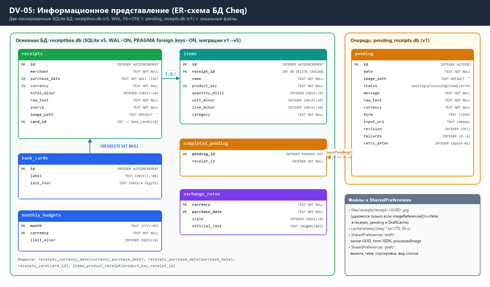

История миграций `receiptbox.db` (`ReceiptStore.Helper.onUpgrade`):
- **v1 → v2**: добавление столбца `receipts.image_path TEXT NOT NULL DEFAULT ''`.
- **v2 → v3**: создание кэша курсов `exchange_rates(currency, purchase_date, scale, official_rate)` и индекса `receipts_purchase_date`.
- **v3 → v4**: создание таблиц `bank_cards` (с `CHECK(length(last_four)=4)`) и `monthly_budgets`, добавление `receipts.card_id REFERENCES bank_cards(id) ON DELETE SET NULL` и индекса `receipts_card`.
- **v4 → v5**: создание таблицы идемпотентности `completed_pending(pending_id INTEGER PRIMARY KEY, receipt_id INTEGER NOT NULL)`.
- **v5 → v6 (реализовано по ADR-0008)**: добавление таблицы `receipt_templates(id INTEGER PRIMARY KEY AUTOINCREMENT, title TEXT NOT NULL, merchant TEXT NOT NULL, currency TEXT NOT NULL, total_minor INTEGER NOT NULL, card_id INTEGER REFERENCES bank_cards(id) ON DELETE SET NULL, items_json TEXT NOT NULL)` с индексом `templates_title` для `SYS-FUNC-016`, а также экспорт/атомарное восстановление всех 6 сущностей в `BackupCodec` (`SYS-FUNC-015`).

Правило ссылочной целостности фотографий: файл `files/receipts/receipt-<UUID>.jpg` удаляется только тогда, когда `ReceiptStore.imageReferenced(path) == false`, `PendingReceiptStore.imageReferenced(path) == false` и файл не указан в `DraftCache`.

- **More Information**: Реализует `REQ-REL-001`, `REQ-REL-003`, `REQ-SEC-001`, `REQ-SEC-002`, `REQ-FUNC-014`, `REQ-FUNC-018`, `REQ-FUNC-020` (`SYS-FUNC-002`, `SYS-NFR-003`, `SYS-NFR-004`). Связанные решения: [ADR-0002](../adr/0002-dual-sqlite-databases-with-wal-and-idempotent-save.md), [ADR-0005](../adr/0005-integer-minor-units-and-nbrb-historical-cross-rates.md), [ADR-0006](../adr/0006-card-data-minimization-and-local-privacy.md).

---

#### `[DV-06]` Спецификация интерфейсов {#dv-06}
- **ID**: `DV-06-interface`
- **Title**: Контракты внешних API (Groq, НБРБ), экспорта TXT и внутренних интерфейсов `:core`
- **Viewpoint**: Interface
- **Representation**:

| Интерфейс | Протокол / Сигнатура | Входные данные | Выходные данные и инварианты | Обработка ошибок |
|---|---|---|---|---|
| **Groq Chat Completions** (`GroqConnection`) | `HTTPS POST https://api.groq.com/openai/v1/chat/completions`, `Bearer <key>`, `Content-Type: application/json`, редиректы отключены | JSON: `model="openai/gpt-oss-20b"`, `temperature=0`, `reasoning_effort="low"`, `response_format={type:"json_schema", strict:true}`, user payload `{text, defaultCurrency, defaultDate}` (≤ 24 000 симв.; **без фото и `cardId`**) | `finish_reason=="stop"`, JSON `purchase_receipt`: `{merchant, date, currency, totalMinor, cardLastFour, items:[{name, quantityMilli, unitMinor, lineMinor, category}]}`, ответ ≤ 256 КБ | `GroqHttpException` (400/401/403/429/5xx), `GroqResponseException` (`TRUNCATED`, `TOO_LARGE`, `NO_ITEMS`, `FORMAT`), `SocketTimeoutException` (55 с), `SSLException` |
| **API НБРБ** (`NbrbRateClient`) | `HTTPS GET https://api.nbrb.by/exrates/rates?ondate={YYYY-MM-DD}&periodicity=0` + фолбэк `/{ISO}?parammode=2&ondate={YYYY-MM-DD}` | Дата `LocalDate`, множество 3-буквенных ISO-кодов (исключая `BYN`) | Массив/объект JSON с полями `Date`, `Cur_Abbreviation`, `Cur_Scale`, `Cur_OfficialRate`; строгая сверка `actualDate == expectedDate`, ответ ≤ 256 КБ | Таймаут `12 с` (connect/read `6 с`), `IOException` не ломает сохранение чека; отсутствующая котировка остаётся в ожидании |
| **TXT Export** (`SelectionSharing`) | Android `FileProvider` (`com.waveberry.cheq.files`, `cache/shares/*.txt`), временный `FLAG_GRANT_READ_URI_PERMISSION` | Набор `receiptIds` или `productKeys` | UTF-8 текстовый файл с магазинами, датами, позициями и исходными валютами; **без `rawText`, фото и данных карт**; автоудаление файлов старше 24 ч | При сбое записи неполный временный файл удаляется в `finally` |
| **Local Archive Backup (CR-01, v0.4)** (`BackupCodec` + SAF) | Android Storage Access Framework (`ACTION_CREATE_DOCUMENT` / `ACTION_OPEN_DOCUMENT`, JSON/ZIP) | Пользовательский URI файла резервной копии (≤ `10 МБ`) | Версионируемый ZIP/JSON (`BackupSnapshot`, `schemaVersion=6`: карты, чеки, позиции, бюджеты, курсы, шаблоны); атомарный импорт без дублей | Проверка размера, `schemaVersion` и всех доменных ограничений до открытия транзакции записи; при ошибке БД остаётся нетронутой |
| **`HistoricalRateSource`** | `List<HistoricalRate> fetch(LocalDate date, Set<String> currencies) throws IOException` | Дата покупки и список нужных валют | Список официальных котировок на указанную дату | Позволяет подменять НБРБ в тестах |
| **`ReceiptRefinement.Cloud`** | `ReceiptDraft parse(ReceiptDraft input) throws Exception` | Черновик с `rawText`, `currency`, `date` | Заполненный черновик чека до пользовательского подтверждения | Позволяет тестировать `RecognitionQueue` и `EditorModel` без реального Groq |

- **More Information**: Реализует `REQ-INT-004`, `REQ-INT-005`, `REQ-FUNC-019`, `REQ-REL-002`, `REQ-SEC-003` (`SYS-FUNC-006`, `SYS-FUNC-008`, `SYS-FUNC-012`, `SYS-NFR-003`). Связанные решения: [ADR-0004](../adr/0004-groq-cloud-parsing-route-worker-vs-direct-https.md), [ADR-0005](../adr/0005-integer-minor-units-and-nbrb-historical-cross-rates.md), [ADR-0006](../adr/0006-card-data-minimization-and-local-privacy.md).

---

#### `[DV-07]` Взаимодействие (сквозной импорт чека) {#dv-07}
- **ID**: `DV-07-interaction`
- **Title**: Последовательность обработки импортированного чека (счастливый путь и отказы)
- **Viewpoint**: Interaction
- **Representation**:

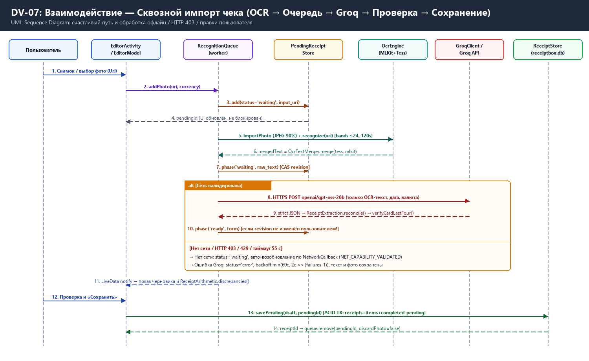

Ключевые инварианты взаимодействия:
1. Закрытие `EditorActivity` не прерывает OCR и облачный разбор — очередь принадлежит процессу приложения (`RecognitionQueue.get(app)`).
2. После получения JSON от Groq выполняется детерминированная постобработка `ReceiptExtraction.reconcile(draft, rawText)` (отсев служебных строк «Итого/НДС/Сдача», распознавание банковских переводов и отклонённых/возвратных чеков) и проверка суффикса карты `GroqClient.verifyCardLastFour()`.
3. Перед записью результата в `PendingReceiptStore` проверяется `revision`: если пользователь уже правил форму в редакторе, поздний ответ не затирает правки, а переводит элемент на повторный пересчёт (`resetStale`).
4. Покупка попадает в `receiptbox.db` исключительно на шаге 13 после нажатия пользователем «Сохранить».

- **More Information**: Реализует `REQ-FUNC-002`, `REQ-FUNC-003`, `REQ-FUNC-004`, `REQ-FUNC-020`, `REQ-ML-002`, `REQ-OBS-001` (`SYS-FUNC-005`, `SYS-FUNC-006`, `SYS-NFR-004`, `SYS-NFR-007`). Связанные решения: [ADR-0002](../adr/0002-dual-sqlite-databases-with-wal-and-idempotent-save.md), [ADR-0003](../adr/0003-hybrid-on-device-ocr-mlkit-and-tesseract.md), [ADR-0004](../adr/0004-groq-cloud-parsing-route-worker-vs-direct-https.md).

---

#### `[DV-08]` Критические алгоритмы {#dv-08}
- **ID**: `DV-08-algorithm`
- **Title**: Алгоритмы полосового OCR, слияния текста, кросс-курсов НБРБ и проверки арифметики
- **Viewpoint**: Algorithm
- **Representation**:

1. **Полосовой тайлинг и адаптивный OCR (`OcrPreparation` + `OcrEngine`)**:
   - Расчёт `inSampleSize = 2^k` так, чтобы площадь декодирования ≤ `12 000 000` пикс. и max сторона ≤ `30 000` пикс.
   - Масштабирование ширины к `TARGET_WIDTH = 1200` (не более `×3.0` и не шире `2000` пикс.), разбиение по вертикали на перекрывающиеся полосы высотой до `2400` пикс. с перекрытием `240` пикс. (≤ `24` полосы); каждая физическая строка приписывается ровно одной полосе по центру `ownTop ≤ center < ownBottom`.
   - Если первый проход Tesseract (`PSM_AUTO`) не даёт читаемого текста (`letters >= 12 && prices > 0`), выполняется второй проход по высококонтрастному изображению (`value = clamp((gray - 160) * 3, 0, 255)`) и при необходимости третий (`PSM_SPARSE_TEXT`) с выбором максимума функции `score = prices * 100 + min(1000, letters) / 5`.

2. **Пространственное слияние двух OCR (`OcrTextMerger.merge(multilingual, latin)`)**:
   - Базой берутся строки Tesseract (`rus+eng`). Для каждой строки ML Kit (`latin`) ищутся пересечения по вертикали (`sameRow > 55%`) и горизонтали (`overlapX > 45%`).
   - Если перекрывающаяся строка содержит кириллицу — она остаётся авторитетной (исключается транслитерация ML Kit), но если справа от неё отсутствует денежная сумма, а ML Kit видит хвост `\d+[.,]\d{2}`, сумма дописывается в ту же строку.
   - Для чисто латинских строк ML Kit заменяет фрагмент Tesseract при длине ≥ `65%`. Итоговые строки сортируются сверху вниз и слева направо, обрезаясь до `24 000` символов. Сложность: `O(N·M)` по числу строк одного чека (`N, M < 500`, выполняется за миллисекунды).

3. **Рациональный кросс-курс через BYN (`HistoricalRate.convertMinor`)**:
   - Пусть `A` — сумма в минорных единицах исходной валюты `S`, `T` — целевая валюта, `r_S, s_S` и `r_T, s_T` — официальные курсы и масштабы НБРБ на дату покупки `d` (при `d < 2016-07-01` масштаб умножается на `10 000` с учётом деноминации BYR → BYN).
   - Точное рациональное выражение с **единственным** округлением `HALF_UP`:
     `result = round_HALF_UP( (A * (r_S if S≠BYN else 1) * (s_T' if T≠BYN else 1)) / ((s_S' if S≠BYN else 1) * (r_T if T≠BYN else 1)) )`
   - В `ReceiptStore.statsConverted()` категории сначала суммируются в исходной валюте чека и только затем конвертируются; разница между суммой сконвертированных категорий и итогом чека явно выносится в «Корректировка чека».

4. **Независимая проверка арифметики (`ReceiptArithmetic.discrepancies`)**:
   - Для каждой позиции: `expected = round_HALF_UP(unitMinor * quantityMilli / 1000)`; флаг расхождения при `|expected - lineMinor| > 1` (допуск `0,01`).
   - По чеку: при непустом списке позиций флаг расхождения при `|sum(lineMinor) - totalMinor| > 1`.

- **More Information**: Реализует `REQ-FUNC-002`, `REQ-FUNC-004`, `REQ-FUNC-010`, `REQ-ML-001`, `REQ-ML-003` (`SYS-FUNC-001`, `SYS-FUNC-005`, `SYS-FUNC-008`). Связанные решения: [ADR-0003](../adr/0003-hybrid-on-device-ocr-mlkit-and-tesseract.md), [ADR-0005](../adr/0005-integer-minor-units-and-nbrb-historical-cross-rates.md).

---

#### `[DV-09]` Динамика состояний очереди распознавания {#dv-09}
- **ID**: `DV-09-state-dynamics`
- **Title**: Конечный автомат элемента очереди `PendingReceiptStore`
- **Viewpoint**: State Dynamics
- **Representation**:

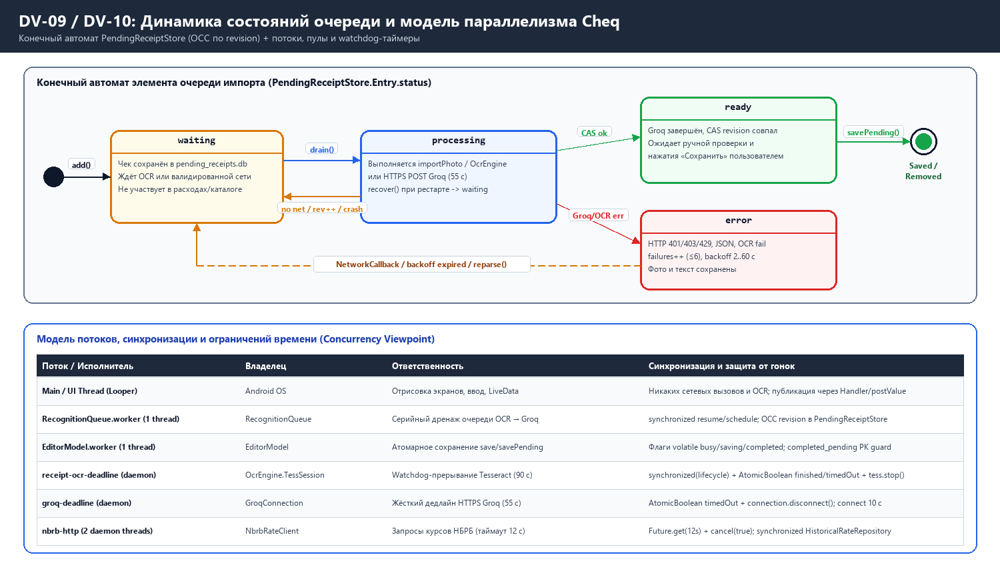

Состояния записи `pending`:
- `waiting` — запись персистентно сохранена, ожидает локального OCR либо валидированного сетевого подключения (по `NetworkCallback`).
- `processing` — активное выполнение импорта фото, `OcrEngine` или HTTP-запроса к Groq; при аварийном завершении процесса метод `PendingReceiptStore.recover()` при старте автоматически возвращает все `processing` в `waiting`.
- `ready` — ответ Groq получен, прошёл `ReceiptExtraction.reconcile()` и CAS-проверку `revision`; чек ожидает проверки и явного сохранения пользователем.
- `error` — зафиксирована ошибка OCR или классифицированная ошибка Groq (`401/403/429/timeout/JSON`), счётчик `failures` увеличивается (≤ 6), вычисляется экспоненциальная задержка повтора `retry_after = now + min(60 000, 2 000 << (failures - 1))`.

- **More Information**: Реализует `REQ-FUNC-020`, `REQ-REL-001`, `REQ-REL-002`, `REQ-OBS-001` (`SYS-FUNC-006`, `SYS-NFR-004`, `SYS-NFR-007`). Связанное решение: [ADR-0002](../adr/0002-dual-sqlite-databases-with-wal-and-idempotent-save.md).

---

#### `[DV-10]` Модель параллелизма и синхронизации {#dv-10}
- **ID**: `DV-10-concurrency`
- **Title**: Потоки выполнения, пулы и примитивы синхронизации Cheq
- **Viewpoint**: Concurrency
- **Representation**:

Сводная таблица потоков приведена в нижней части диаграммы [DV-09 / DV-10](diagrams/06-state-concurrency.png):
- **UI Thread (`Looper.getMainLooper`)** — исключительно отрисовка, пользовательский ввод и подписка на `LiveData` / `Handler.post`.
- **`RecognitionQueue.worker`** — однопоточный `ScheduledExecutorService`, последовательно дренирующий очередь (`drain`) с защитой `synchronized resume()/schedule()` и дедупликацией попыток по ключу `id:revision` (исключает бесконечные самоповторы при отказе).
- **`EditorModel.worker`** — однопоточный `ExecutorService` для транзакционного `save`/`savePending` с `volatile`-гардами `busy/saving/completed`.
- **Сторожевые (watchdog) daemon-потоки**: `receipt-ocr-deadline` (90 с, вызывает `tess.stop()` под `synchronized(lifecycle)`) и `groq-deadline` (55 с, вызывает `connection.disconnect()`).
- **`nbrb-http` (пул 2 daemon-потоков)** — ограничение блокирующих вызовов `HttpURLConnection` через `Future.get(12s)` + `cancel(true)`; координация запросов в `HistoricalRateRepository` через `synchronized` и 60-секундный backoff на пару `(currency, date)`.

- **More Information**: Реализует `REQ-PERF-002`, `REQ-FUNC-020`, `REQ-REL-001` (`SYS-NFR-002`, `SYS-NFR-004`). Связанные решения: [ADR-0002](../adr/0002-dual-sqlite-databases-with-wal-and-idempotent-save.md), [ADR-0003](../adr/0003-hybrid-on-device-ocr-mlkit-and-tesseract.md).

---

#### `[DV-11]` Архитектурные и проектные паттерны {#dv-11}
- **ID**: `DV-11-patterns`
- **Title**: Применённые архитектурные и проектные паттерны Cheq
- **Viewpoint**: Patterns
- **Representation**:

| Паттерн | Где применён | Решаемая задача |
|---|---|---|
| **Modular Core / Dependency Inversion** | `:app → :core`, `HistoricalRateSource`, `ReceiptRefinement.Cloud` | Изоляция расчётов и парсеров от Android SDK, 100% тестируемость на JVM |
| **MVVM (`AndroidViewModel` + `LiveData`)** | `EditorActivity` ↔ `EditorModel` | Сохранение состояния формы при повороте экрана, реактивное обновление UI |
| **Repository** | `ReceiptStore`, `PendingReceiptStore`, `HistoricalRateRepository` | Сокрытие SQLite-схем, кэширования курсов и транзакций за доменным API |
| **Application-Scoped Singleton Worker** | `RecognitionQueue.get(Context)` | Жизненный цикл фоновой очереди независим от закрытия `EditorActivity` |
| **Optimistic Concurrency Control (CAS)** | `PendingReceiptStore.edit()` / `phase(... WHERE revision=?)` | Защита ручных правок пользователя от перезаписи поздним ответом Groq |
| **Idempotent Consumer** | `ReceiptStore.savePending()` + `completed_pending` | Исключение дублирования покупок при повторном сохранении или сбое очистки очереди |
| **Graceful Degradation / Fallback** | `OcrEngine` (ML Kit / Tesseract), `OcrPreparation` (contrast / sparse), `NbrbRateClient` (`parammode=2`) | Сохранение работоспособности при отказе одного OCR-движка или нестандартной котировке |
| **Exponential Backoff + Network Observer** | `RecognitionQueue` (`2с..60с`, `NetworkCallback`), `HistoricalRateRepository` (`60с`) | Защита от шторма запросов при недоступности сети или HTTP 429/403 |

- **More Information**: Реализует `REQ-MAINT-001`, `REQ-REUSE-001`, `REQ-REL-001`, `REQ-REL-002` (`SYS-NFR-004`, `SYS-NFR-006`). Связанные решения: [ADR-0001](../adr/0001-separate-pure-java-core-module.md), [ADR-0002](../adr/0002-dual-sqlite-databases-with-wal-and-idempotent-save.md).

---

#### `[DV-12]` Развёртывание и управление ресурсами {#dv-12}
- **ID**: `DV-12-deployment-resources`
- **Title**: Топология развёртывания, конвейер сборки и квоты ресурсов
- **Viewpoint**: Deployment & Resources
- **Representation**:

Топология развёртывания показана на диаграмме [DV-01 / DV-11](diagrams/01-context-architecture.png). Сборка выполняется через Gradle Wrapper (`8.13`, AGP `8.13.2`, JDK `17`) скриптом `Build-Cheq.cmd` / `scripts/build.ps1`:
- `prepareGroqKey` переносит локальный игнорируемый `GroqApi.key` в `generated/groqAssets/groq.key` (пустой файл допустим для офлайн-сборки).
- `prepareAppIcon` подготавливает растровую иконку приложения.
- Release-конфигурация включает `minifyEnabled true`, `shrinkResources true` (R8) и фильтрацию ABI `arm64-v8a`.

Квоты и ограничения ресурсов времени выполнения:

| Ресурс | Ограничение / Квота | Механизм контроля |
|---|---|---|
| Оперативная память (`Bitmap` OCR) | ≤ `12 000 000` пикс. при декодировании, ≤ `24` полосы (`2400` пикс.), обязательный `recycle()` в `finally` | `OcrPreparation.sampleSize/bands`, `OcrEngine.recognize` |
| Время CPU / сети | OCR ≤ `120 с` (Tesseract `90 с`, ML Kit `25 с`/полоса); Groq ≤ `55 с` (connect `10 с`); НБРБ ≤ `12 с` (connect/read `6 с`) | Daemon-таймеры `receipt-ocr-deadline`, `groq-deadline`, `Future.get` |
| Объём данных чека и HTTP-ответов | Позиций ≤ `200`, `rawText` ≤ `24 000` симв., сумма ≤ `10^11` минорных ед., HTTP-ответ Groq/НБРБ ≤ `256 КБ` | `ReceiptDraft.validate()`, `GroqConnection`, `NbrbRateClient` |
| Файловое хранилище | Фото чека JPEG 90% в приватном `files/receipts/`; удаление при обнулении ссылок; TTL экспортов `cache/shares/*.txt` = `24 ч` | `ReceiptPhotos`, `ReceiptStore.deleteReceipts`, `SelectionSharing` |
| SQLite пакетные запросы | Разбиение `IN (...)` пакетами по ≤ `400` параметров (ниже лимита SQLite `SQLITE_MAX_VARIABLE_NUMBER = 999`) | `ReceiptStore.deleteReceipts / setReceiptCards / setProductCategory` |

- **More Information**: Реализует `REQ-INST-001`, `REQ-BUILD-001`, `REQ-DIST-001`, `REQ-PORT-001`, `REQ-PERF-002` (`SYS-FUNC-013`, `SYS-NFR-002`, `SYS-NFR-009`). Связанное решение: [ADR-0007](../adr/0007-arm64-only-distribution-and-r8-packaging.md).

---

### 3.4 Матрица трассируемости {#34-traceability-matrix}

Сквозная прослеживаемость от бизнес-целей SRS к системным требованиям, элементам дизайна SDD, протоколам ADR, исходному коду Cheq 1.0 и автоматическим тестам:

| Бизнес-цель (SRS) | Требования SRS (`REQ-*`) | Системные требования (`SYS-*`) | Блок плана | Представления SDD (`DV-*`) | Решения ADR | Основные классы Cheq | Тестовые наборы |
|---|---|---|---|---|---|---|---|
| `BG-01` | `REQ-FUNC-001..003`, `REQ-INT-002..003`, `REQ-INT-005`, `REQ-PERF-002`, `REQ-AVAIL-001`, `REQ-INST-001`, `REQ-PORT-001`, `REQ-POC-001`, `REQ-ML-001` | `SYS-FUNC-001`, `003`, `005`, `006`, `013`; `SYS-NFR-002`, `005`, `008`, `009` | `F-01`, `F-03`, `F-05`, `F-06`, `F-13` | `DV-01`, `DV-02`, `DV-03`, `DV-06`, `DV-07`, `DV-08`, `DV-10`, `DV-12` | `ADR-0001`, `0003`, `0004`, `0007` | `EditorActivity`, `EditorModel`, `CameraActivity`, `OcrEngine`, `OcrTextMerger`, `GroqClient`, `GroqReceiptApi` | `OcrTextMergerTest`, `OcrPreparationTest`, `GroqReceiptApiTest`, `GroqConnectionTest`, `EditorStateTest`, `NativeFlowTest` |
| `BG-02` | `REQ-INT-001`, `REQ-FUNC-006..008`, `REQ-FUNC-017`, `REQ-FUNC-019`, `REQ-PERF-001` | `SYS-FUNC-004`, `007`, `011`, `012`; `SYS-NFR-001` | `F-04`, `F-07`, `F-11`, `F-12` | `DV-02`, `DV-03`, `DV-05`, `DV-06`, `DV-12` | `ADR-0002`, `0006` | `MainActivity`, `ReceiptBrowser`, `ProductBrowser`, `SelectionModel`, `SelectionSharing`, `ReceiptStore` | `ReceiptBrowserTest`, `GalleryUiTest`, `GalleryStoreTest`, `MultiSelectionTest`, `BatchSelectionStoreTest` |
| `BG-03` | `REQ-INT-004`, `REQ-FUNC-009..014`, `REQ-FUNC-016` | `SYS-FUNC-008`, `009`, `010` | `F-08`, `F-09`, `F-10` | `DV-03`, `DV-05`, `DV-06`, `DV-08` | `ADR-0005`, `0006` | `HistoricalRate`, `NbrbRateClient`, `HistoricalRateRepository`, `BudgetProgress`, `CardManager`, `ReceiptStore` | `HistoricalRateTest`, `NbrbRateClientTest`, `BudgetProgressTest`, `HistoricalRatesStoreTest`, `CardSpendingStoreTest`, `MixedCurrencyUiTest` |
| `BG-04` | `REQ-FUNC-004..005`, `REQ-FUNC-015`, `REQ-FUNC-018`, `REQ-FUNC-020..021`, `REQ-REL-001..003`, `REQ-OBS-001`, `REQ-BUILD-001`, `REQ-MAINT-001`, `REQ-REUSE-001`, `REQ-DEAD-001`, `REQ-CM-001`, `REQ-ML-002..003` | `SYS-FUNC-001..003`, `006`, `010`, `011`, `014`; `SYS-NFR-004`, `006`, `007`, `008` | `F-01..03`, `F-06`, `F-10`, `F-11`, `F-14` | `DV-02`, `DV-04`, `DV-05`, `DV-07`, `DV-08`, `DV-09`, `DV-10`, `DV-11` | `ADR-0001`, `0002`, `0003`, `0004`, `0005` | `ReceiptArithmetic`, `ReceiptExtraction`, `BankReceiptParser`, `PendingReceiptStore`, `RecognitionQueue`, `GroqErrors`, `DraftCache` | `ReceiptArithmeticTest`, `ReceiptCoreTest`, `ReceiptStoreTest`, `EditorRefinementTest`, `TotalOnlyReceiptTest`, `GroqErrorsTest`, `SteamReceiptReviewTest` |
| `BG-05` | `REQ-SEC-001..003`, `REQ-COMP-001`, `REQ-DIST-001`, `REQ-COST-001` | `SYS-FUNC-010`, `012`, `013`, `015`; `SYS-NFR-003`, `005`, `010` | `F-06`, `F-10`, `F-12`, `F-13`, `F-15` | `DV-01`, `DV-04`, `DV-05`, `DV-06`, `DV-12` | `ADR-0004`, `0006`, `0007`, `0008` | `AndroidManifest.xml`, `network_security_config.xml`, `ReceiptPhotos`, `SelectionSharing`, `GroqClient`, `BackupCodec`, `THIRD_PARTY.md` | `CardLastFourTest`, `GroqCardLastFourTest`, `EditorCardExtractionTest`, `SettingsRequirementsTest` |
| `CR-01`, `CR-02` (PR #3) | Изменения Раунда 2 (отказ от перекл. тем; бэкап SAF + шаблоны покупок) | `SYS-FUNC-015`, `SYS-FUNC-016` | `F-15`, `F-16` | `DV-05` (v6), `DV-06` (SAF), `План v3`, `UML 3.5` | `ADR-0008`, `0009` | `BackupSnapshot`, `BackupCodec` (`:core`), `ReceiptStore` v6, `SettingsPanel`, `EditorActivity`, `MainActivity` | `BackupCodecTest`, `BackupRestoreStoreTest`, `TemplateMigrationStoreTest`, `HistoricalRatesStoreTest` |

---

### 3.5 Модель динамического поведения системы (UML 2.5) {#35-uml-dynamic-behavior}

В рамках лабораторной работы № 5 архитектурные представления `DV-07` (Interaction) и `DV-09` (State Dynamics) расширены до полной модели динамического поведения системы Cheq в текстовой нотации PlantUML (`uml/models/*.puml`) с вынесенными артефактами спецификаций:

- **Глоссарий проекта (табличная форма):** [uml/glossary.md](../uml/glossary.md) — 26 предметных и инженерных терминов Cheq.
- **Дополнительные спецификации:** [uml/supplementary-specifications.md](../uml/supplementary-specifications.md) — сквозные бизнес-правила (`BR-01`–`BR-06`), квоты ресурсов, требования надёжности, безопасности и сопровождаемости.
- **Спецификации актёров и прецедентов (Flow of Events):** [uml/use-case-specifications.md](../uml/use-case-specifications.md) — краткие описания 5 актёров (1–2 строки) и полные потоки событий (пояснения, предусловия, основной, альтернативные и ошибочные потоки, постусловия) для всех 10 прецедентов (`UC-01`–`UC-10`).

#### 3.5.1 Диаграмма вариантов использования (Use Case Diagram)
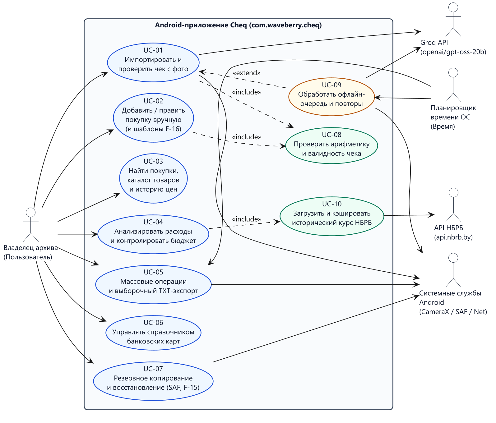
Исходный файл: [uml/models/01-use-case.puml](../uml/models/01-use-case.puml). Отражает границы системы Cheq, 5 внешних актёров (без связей между актёрами), 7 пользовательских (`UC-01`–`UC-07`) и 3 вспомогательных прецедента (`UC-08`–`UC-10`) со связями коммуникации, `<<include>>` (`UC-08`, `UC-10`) и `<<extend>>` (`UC-09`).

#### 3.5.2 Диаграмма активности (Activity Diagram)
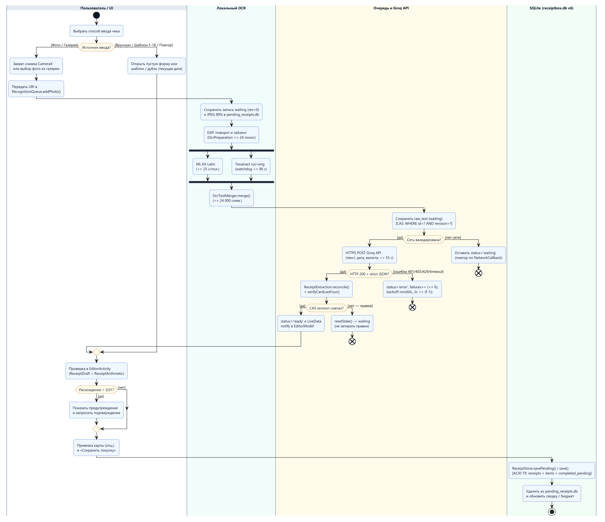
Исходный файл: [uml/models/02-activity-receipt-import.puml](../uml/models/02-activity-receipt-import.puml). Моделирует сквозной поток управления между 4 дорожками ответственности (`Пользователь / UI`, `Локальный OCR`, `Очередь и Groq API`, `SQLite (receiptbox.db v6)`), включая параллельный `fork/join` гибридного OCR (ML Kit + Tesseract), ветвления по валидации сети, `CAS revision` и `ReceiptArithmetic`.

#### 3.5.3 Диаграмма состояний (State Machine Diagram)
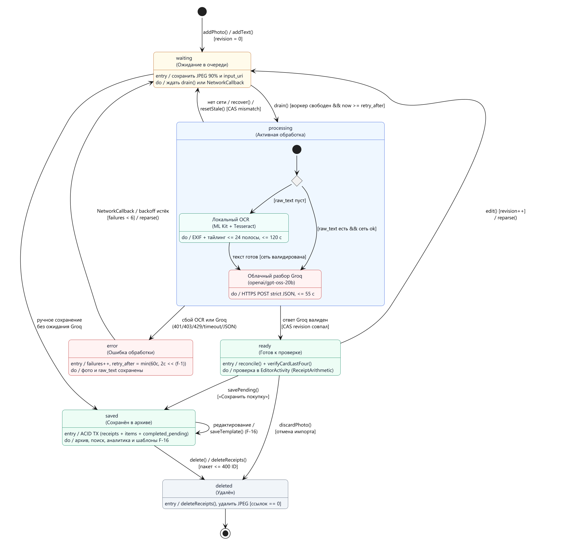
Исходный файл: [uml/models/03-state-machine-receipt.puml](../uml/models/03-state-machine-receipt.puml). Детализирует полный жизненный цикл чека от импорта до удаления: составное состояние `processing` (`<<choice>>`, `Локальный OCR` → `Облачный разбор Groq`), `waiting` (`revision = 0`), `ready`, `error` (экспоненциальный backoff и `NetworkCallback`), `saved` и `deleted` (с проверкой ссылочной целостности фото `[ссылок == 0]`).

#### 3.5.4 Диаграммы последовательности (Sequence Diagrams)
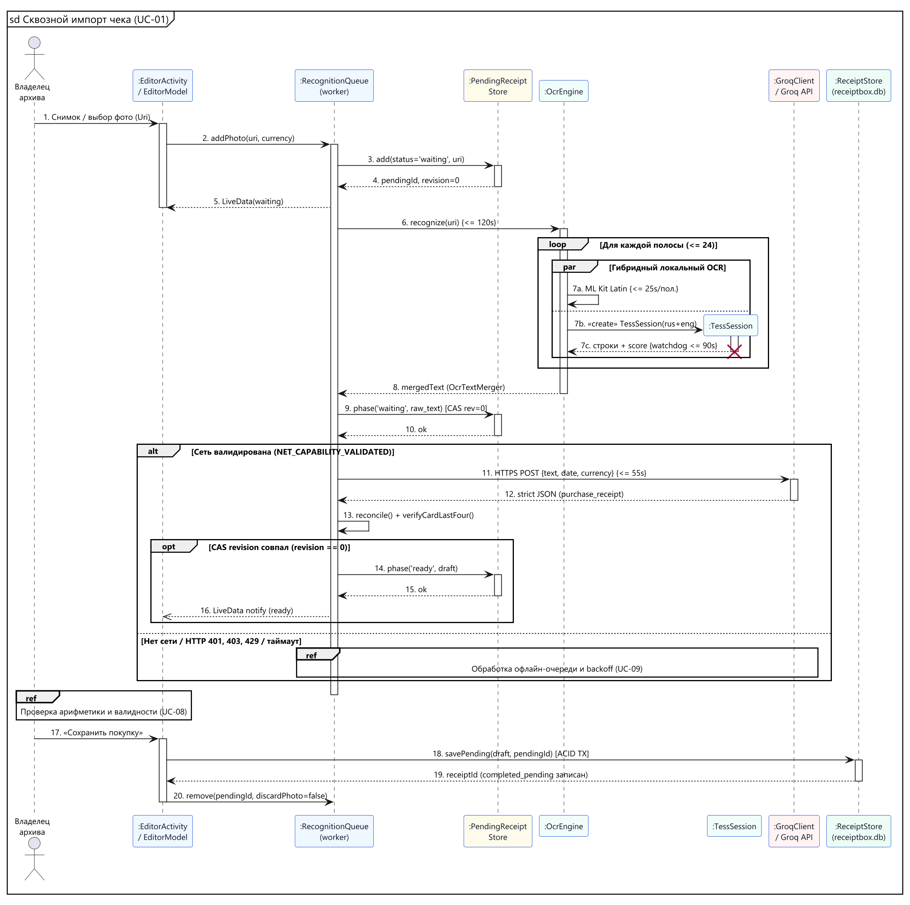
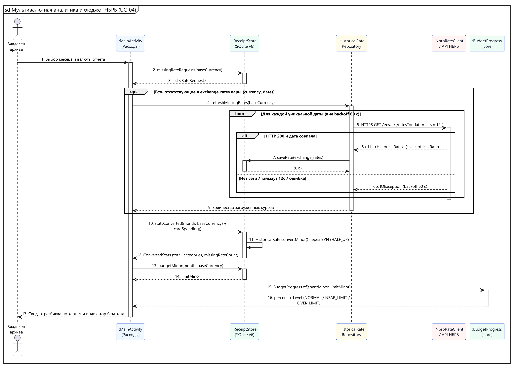
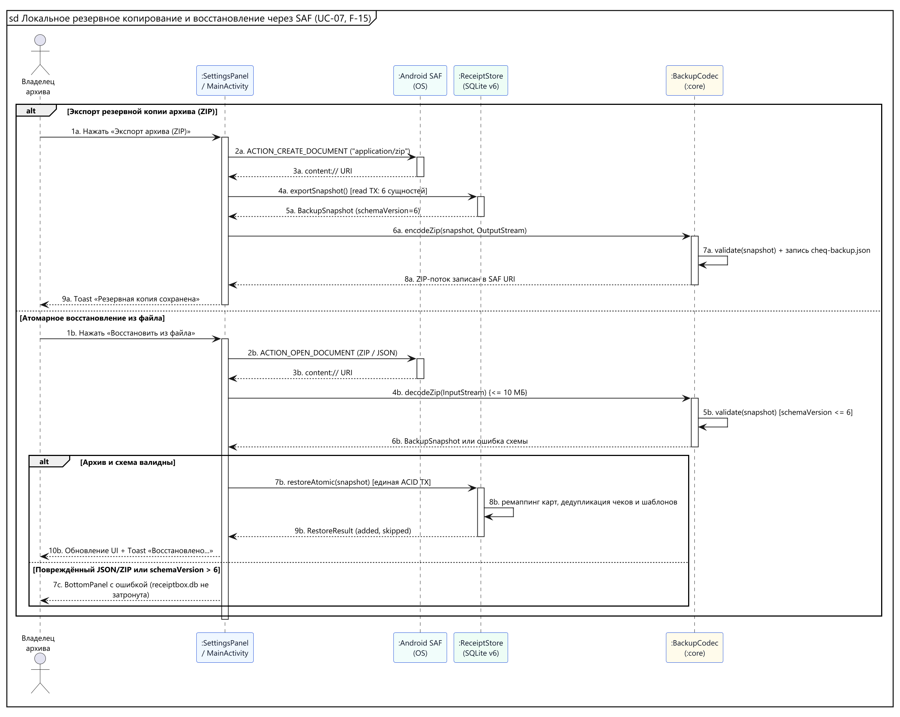
Исходные файлы: [04-sequence-receipt-import.puml](../uml/models/04-sequence-receipt-import.puml), [05-sequence-budget-nbrb.puml](../uml/models/05-sequence-budget-nbrb.puml) и [06-sequence-backup-restore.puml](../uml/models/06-sequence-backup-restore.puml). Выполняют проекцию сценариев `UC-01`, `UC-04` (`UC-10`) и `UC-07` (`F-15`) на реальные классы Cheq в нотации UML 2.5 (фреймы `sd`, линии жизни, активации, `«create»`/`destroy`, временные ограничения `{<= 120s}`/`{<= 55s}`/`{<= 12s}`, фрагменты `loop`, `par`, `alt`, `opt`, `ref`).

---

## 4. Решения (ADR) {#4-decisions}

Значимые архитектурные решения документируются в формате MADR 4.0 в каталоге [adr/](../adr/README.md). Ниже приведён сводный реестр решений версии 0.2:

| ID | Заголовок | Статус | Краткий итог | Файл |
|---|---|---|---|---|
| `ADR-0001` | Выделение чистого Java-модуля `:core` без Android-зависимостей | `accepted` | Двухмодульная структура `:app → :core` (Java 17 + Gson) гарантирует независимое тестирование расчётов и парсеров | [0001-separate-pure-java-core-module.md](../adr/0001-separate-pure-java-core-module.md) |
| `ADR-0002` | Две изолированные SQLite БД (`receiptbox.db` WAL + `pending_receipts.db`) с идемпотентным сохранением | `accepted` | Физическая изоляция очереди исключает попадание черновиков в расходы; `completed_pending` и OCC по `revision` защищают от дублей и гонок | [0002-dual-sqlite-databases-with-wal-and-idempotent-save.md](../adr/0002-dual-sqlite-databases-with-wal-and-idempotent-save.md) |
| `ADR-0003` | Гибридный локальный OCR (ML Kit Latin + Tesseract `rus+eng`) с полосовым тайлингом и `OcrTextMerger` | `accepted` | Фотографии не покидают устройство; слияние строк с приоритетом кириллицы и резервированием движков | [0003-hybrid-on-device-ocr-mlkit-and-tesseract.md](../adr/0003-hybrid-on-device-ocr-mlkit-and-tesseract.md) |
| `ADR-0004` | Маршрут облачного разбора Groq (`openai/gpt-oss-20b`, strict JSON): Worker против прямого HTTPS | `accepted` | Согласован прямой HTTPS к Groq в Раунде 1 (PR #3): экономия 16 ч / $400 vs Cloudflare Worker | [0004-groq-cloud-parsing-route-worker-vs-direct-https.md](../adr/0004-groq-cloud-parsing-route-worker-vs-direct-https.md) |
| `ADR-0005` | Целые сотые доли (`long`) и исторический кросс-курс через BYN по API НБРБ | `accepted` | Исключение ошибок `float`, рациональный кросс-курс с единственным `HALF_UP`, локальный кэш и честная маркировка неполных сводок | [0005-integer-minor-units-and-nbrb-historical-cross-rates.md](../adr/0005-integer-minor-units-and-nbrb-historical-cross-rates.md) |
| `ADR-0006` | Минимизация карточных данных, приватность локального хранилища и TXT-экспорт через `FileProvider` | `accepted` | Только `label` + `last_four`, `allowBackup=false`, запрет HTTP cleartext, экспорт без OCR и карт с TTL 24 ч | [0006-card-data-minimization-and-local-privacy.md](../adr/0006-card-data-minimization-and-local-privacy.md) |
| `ADR-0007` | Ограничение нативной поставки архитектурой `arm64-v8a` с R8-оптимизацией и CLI-сборкой | `accepted` | Компактный ARM64 APK с встроенными OCR-моделями и воспроизводимой сборкой Gradle/JDK 17 без Android Studio | [0007-arm64-only-distribution-and-r8-packaging.md](../adr/0007-arm64-only-distribution-and-r8-packaging.md) |
| `ADR-0008` | Интеграция локального бэкапа (`F-15`), шаблонов покупок (`F-16`) и привлечение Junior-разработчика на итерации 4–5 | `accepted` | Сохранение жёсткого дедлайна 10 недель и бюджета $9 550 (+9,8% к v2) за счёт подключения Junior ($10/ч, 1,5×) на изолированные UI-задачи с code review Middle (16 ч) | [0008-local-backup-templates-and-junior-onboarding.md](../adr/0008-local-backup-templates-and-junior-onboarding.md) |
| `ADR-0009` | Моделирование динамического поведения системы Cheq в текстовой нотации UML (Diagrams-as-Code) и механизмы связей | `accepted` | Выбор PlantUML (`.puml`) + раздельных спецификаций; четырёхуровневая сквозная связь Use Case → Activity → State Machine → Sequence с кодом и SDD v0.4 | [0009-uml-dynamic-behavior-modeling-and-text-as-code.md](../adr/0009-uml-dynamic-behavior-modeling-and-text-as-code.md) |

---

## 5. Приложения {#5-appendixes}

1. **Эволюция итерационных планов и переписка с Заказчиком**:
   - [Первичный план v1](plan-v1.md) — 14 блоков, 392 ч, 6 итераций (12 недель), $9 800;
   - [Изменённый план v2 (Раунд 1)](plan-v2.md) — оптимизация −44 ч, 348 ч, 5 итераций (10 недель), $8 700;
   - [Согласованный итоговый план v3 (Раунд 2)](plan-v3.md) — добавлены `F-15`/`F-16`, Middle (340 ч) + Junior (105 ч на Итер. 4–5), 5 итераций (10 недель), $9 550 (+9,8%);
   - [Журнал переписки и согласования (PR #3)](negotiations.md).
2. **Архитектурные и плановые диаграммы (`sdd/diagrams/`)**:
   - [01-context-architecture.png](diagrams/01-context-architecture.png) — контекст системы и развёртывание (`DV-01`, `DV-12`);
   - [02-component-composition.png](diagrams/02-component-composition.png) — композиция модулей и зависимости (`DV-02`, `DV-04`);
   - [03-logical-class-diagram.png](diagrams/03-logical-class-diagram.png) — логическая структура классов (`DV-03`);
   - [04-er-database-schema.png](diagrams/04-er-database-schema.png) — ER-схема `receiptbox.db` и `pending_receipts.db` (`DV-05`);
   - [05-sequence-import-flow.png](diagrams/05-sequence-import-flow.png) — диаграмма последовательности импорта чека (`DV-07`);
   - [06-state-concurrency.png](diagrams/06-state-concurrency.png) — автомат очереди и модель потоков (`DV-09`, `DV-10`);
   - [07-plan-v1-roadmap.png](diagrams/07-plan-v1-roadmap.png) — дорожная карта Плана v1;
   - [08-plan-v2-roadmap.png](diagrams/08-plan-v2-roadmap.png) — дорожная карта Плана v2;
   - [09-plan-v3-roadmap.png](diagrams/09-plan-v3-roadmap.png) — дорожная карта согласованного Плана v3 (Middle + Junior);
   - [10-plans-comparison.png](diagrams/10-plans-comparison.png) — сравнение всех версий плана по срокам и стоимости.
3. **Модель динамического поведения UML 2.5 (`uml/`)**:
   - [uml/glossary.md](../uml/glossary.md) — глоссарий проекта в табличной форме;
   - [uml/supplementary-specifications.md](../uml/supplementary-specifications.md) — дополнительные спецификации и бизнес-правила;
   - [uml/use-case-specifications.md](../uml/use-case-specifications.md) — описания актёров и потоки событий прецедентов (`UC-01`–`UC-10`);
   - `uml/models/*.puml` и `uml/diagrams/*.png` — 6 текстовых UML-моделей и их PNG-рендеров (Use Case, Activity, State Machine, 3 Sequence).
4. **Автоматическое тестовое покрытие кодовой базы Cheq 1.0**:
   - Модуль `:core` (19 наборов JUnit 4, 149 тестов): `BackupCodecTest`, `BudgetProgressTest`, `CardLastFourTest`, `DigitalReceiptTest`, `GroqConnectionTest`, `GroqErrorsTest`, `GroqReceiptApiTest`, `GroqReviewTest`, `GroqTransferTest`, `HistoricalRateTest`, `MultiReceiptRulesTest`, `NbrbRateClientTest`, `OcrTextMergerTest`, `ReceiptArithmeticTest`, `ReceiptCoreTest`, `ReceiptDiversityTest`, `ReceiptRefinementTest`, `SteamReceiptReviewTest`, `TotalOnlyReceiptTest`.
   - Модуль `:app` (31 набор Robolectric 4.16 / AndroidX Test): `BackupRestoreStoreTest`, `TemplateMigrationStoreTest`, `GroqCardLastFourTest`, `BatchSelectionStoreTest`, `CardSpendingStoreTest`, `GalleryStoreTest`, `HistoricalRatesStoreTest`, `PreferencesDataTest`, `ReceiptStoreTest`, `TotalOnlyStoreTest`, `OcrPreparationTest`, `BottomPanelTest`, `CardSpendingUiTest`, `ChoiceInteractionTest`, `EditorCardExtractionTest`, `EditorRefinementTest`, `EditorStateTest`, `ExpensesHeaderTest`, `FrostedSurfaceShadowTest`, `FrostedSurfaceTest`, `GalleryPreviewTest`, `GalleryUiTest`, `MixedCurrencyUiTest`, `MultiSelectionTest`, `NativeFlowTest`, `RateRefreshLifecycleTest`, `ReceiptBrowserTest`, `SelectionHeaderGeometryTest`, `SettingsChoiceLifecycleTest`, `SettingsRequirementsTest`, `TotalOnlyUiTest`.
