# Спецификация требований к ПО

Для Android-приложения Cheq

Версия документа 1.2 · Исходники приложения 0.9.0

Подготовил: А. В. Голуб, группа 434701

БГУИР · 30.10.2026

## Оглавление

- [1 Введение](#1-введение)
- [2 Обзор продукта](#2-обзор-продукта)
- [3 Требования](#3-требования)
- [4 Верификация](#4-верификация)
- [5 Приложения](#5-приложения)

## История изменений

| Автор | Дата | Изменение | Версия |
|---|---|---|---|
| А. В. Голуб | 27.10.2026 | Подготовлена спецификация Cheq по текущим исходникам 0.8.0 и шаблону учебного репозитория | 1.0 |
| А. В. Голуб | 30.10.2026 | Уточнены автоматический Groq, сохраняемая очередь, конфигурация Worker и публикация учебного репозитория | 1.1 |
| А. В. Голуб | 30.10.2026 | Полная графическая часть: шесть тематических моделей, проверенный реестр требований, 13 экспортов ядра SysML и отчёт | 1.2 |

## 1 Введение

### 1.1 Назначение документа

Документ определяет бизнес-цели, границы и проверяемые требования к Cheq для владельца продукта, напарника в роли заказчика, преподавателя и разработчика. Спецификация используется для обсуждения и проверки поведения приложения. Требования согласуются с заказчиком, а выполнение критериев приёмки фиксируется в матрице верификации.

### 1.2 Область применения продукта

Cheq 0.9.0 — мобильное Android-приложение для личного учёта купленных товаров, чеков и расходов. Выбран **вариант 3** задания: предоставление информации о купленных товарах; отличительная возможность — локальное чтение текста и автоматический облачный разбор чеков с сохраняемой очередью. Источник сведений — собственные чеки пользователя, поэтому каталоги Amazon или аналогичные сервисы не требуются. НБРБ используется для исторических курсов, Groq — для выделения товаров из текста. Ручной ввод доступен без облака.

В объём входят ручной ввод и импорт фото, редактор, архив, история цен, категории, месячный бюджет, мультивалютные расчёты, справочник карт и TXT-экспорт. За границами: платежи и подключение к банковским счетам, учёт доходов, возвраты с отрицательными суммами, совместный бюджет, синхронизация, полная резервная копия, рекомендации товаров, календарь будущих списаний и версии для iOS/Web/Desktop.

### 1.3 Определения, акронимы и сокращения

| Термин | Определение |
|---|---|
| SRS | Спецификация требований к программному обеспечению |
| SysML v2 | Язык моделирования систем, используемый для структуры экранов и требований |
| OCR | Преобразование изображения текста в текстовые данные |
| Черновик | Неподтверждённый результат ввода или распознавания до сохранения |
| Покупка | Подтверждённая запись с датой, валютой, итогом и необязательными позициями |
| Общая валюта | Валюта отображения агрегированных расходов, не меняющая исходную запись |
| Исторический курс | Официальный курс на дату покупки с учётом масштаба котировки |
| Карта | Локальное название способа оплаты и последние четыре цифры, без банковского доступа |
| Неполный расчёт | Сводка, для которой отсутствует хотя бы один необходимый курс |
| Приёмка | Подтверждение согласованных критериев, отличное от наличия кода |

### 1.4 Ссылки

1. [Задание лабораторной работы № 3](Лабораторная%20работа%203.pdf), БГУИР, 3 с. Обязательный источник состава работы.
2. [Шаблон `srs/srs-template.md`](sources/srs-template.md) из репозитория лабораторной № 2: источник структуры документа.
3. [README Cheq](sources/Cheq-README.md), исходники версии 0.9.0, модули `app`/`core`, исследованы 30.10.2026. Источник фактического поведения, не доказательство запуска на устройстве.
4. [Официальные примеры SysML v2](https://github.com/Systems-Modeling/SysML-v2-Release/tree/master/sysml/src/examples/Simple%20Tests). Источник синтаксиса текстовой модели, проверен 27.10.2026.
5. [Сведения о сторонних компонентах Cheq](sources/Cheq-THIRD_PARTY.md).

### 1.5 Обзор документа

Раздел 2 задаёт ценность и ограничения продукта; раздел 3 содержит обязательства с устойчивыми ID, обоснованием и критериями приёмки. Раздел 4 связывает требования с проверками. Раздел 5 содержит проверенные модели и их PNG-представления. Слова «должно» задают требуемое поведение; численные ориентиры производительности помечены как предлагаемые, пока заказчик их не подтвердит.

## 2 Обзор продукта

### 2.1 Перспектива продукта

Cheq — самостоятельное приложение одного владельца на одном устройстве. Ценность состоит в замене ручного переноса данных из чеков единым архивом, историей цен и прозрачной месячной сводкой. Регистрация и серверное хранение архива не требуются. Старый модуль proxy не требуется. Исходники поддерживают два маршрута Groq: HTTPS-запрос напрямую либо через настроенный Cloudflare Worker. Наличие WorkerClient.properties выбирает маршрут при сборке; без него сохраняется прямой режим. Фактический успешный облачный разбор и готовность APK 0.9 в этой работе не подтверждались.

Бизнес-цели приведены ниже. Численные метрики являются предложением для согласования, а не результатом испытаний.

**BG-01 — Сократить ручной перенос покупок.** Ввод из фото или текста с проверкой перед сохранением. Предлагаемая метрика: медианное время регистрации чека из 5 позиций по 10 попыткам не более 60 с и минимум на 30% меньше ручного ввода того же набора. Цели ещё не измерены.

**BG-02 — Сделать архив покупок доступным для поиска.** Поиск по магазину, товару и дате, история цен и выборочный экспорт. Проверка: из заранее подготовленного архива пользователь находит заданную покупку; порог отклика описан в PERF-001.

**BG-03 — Показывать месячные расходы и остаток бюджета.** Для полного набора курсов сводка должна совпадать с контрольным расчётом до 0,01; при пропущенном курсе результат явно неполный. Распределение по картам должно сходиться с итогом.

**BG-04 — Сохранить достоверность внесённых данных.** Ни один из сценариев отказа сети, поворота и позднего облачного ответа не должен терять подтверждённую покупку; арифметическое расхождение показывается до сохранения.

**BG-05 — Ограничить передачу и стоимость обработки.** Ручной учёт и архив работают без облака; импорт без сети сохраняется до возобновления анализа. Фото и внутренние идентификаторы карт не включаются в облачный запрос; исходный OCR-текст может содержать напечатанные реквизиты; TXT содержит только выбранные разрешённые поля.

### 2.2 Функции продукта

- Добавление покупки с камеры, из фото, текста или вручную;
- проверка черновика, арифметики и состава до сохранения;
- просмотр и поиск чеков, история цен, категории;
- расходы по месяцам и картам, бюджет и исторические курсы;
- массовые действия и выборочный TXT-экспорт;
- локальный ручной учёт, темы оформления и автоматический Groq для импортированных чеков;
- очередь импорта с восстановлением после завершения процесса и исключением дублей сохранения.

### 2.3 Ограничения продукта

Поддерживаются Android 8.0+ (API 26), Java 17 и XML-интерфейс; текущая сборка задаёт compileSdk/targetSdk 36. Деньги хранятся в целых сотых долях валюты, количество — в тысячных долях; пересчёт использует десятичную арифметику. Чек содержит не более 200 позиций, исходный текст — не более 24000 символов. Приложение поддерживает BYN, RUB, EUR, USD, KZT и PLN. Качество OCR зависит от читаемости снимка; утверждение о 100% точности отсутствует.

В прямом режиме сборка помещает Groq-ключ в APK; он извлекаем. При настройке Worker ключ Groq остаётся на сервере, но клиентский токен присутствует в APK и также не считается нераскрываемым секретом. Исходный ключ в материалы лабораторной не включается. Приватное размещение SQLite не означает шифрование всей базы. Удаление приложения удаляет архив; TXT-экспорт не является полной резервной копией.

### 2.4 Характеристики пользователей

Основной пользователь ведёт личные расходы, умеет фотографировать документ и пользоваться Android, но не обязан понимать устройство OCR, JSON или API. Он добавляет покупки, исправляет данные и устанавливает бюджет. Напарник и преподаватель выступают заказчиками и рецензентами требований. Разработчик сопровождает приложение и тесты. НБРБ и Groq являются внешними системами, а не пользовательскими ролями. Администратор сервера и совместные аккаунты не предусмотрены.

### 2.5 Допущения и зависимости

| Условие | Последствие нарушения | Предусмотренная реакция |
|---|---|---|
| Снимок читаем, язык русский или английский | OCR может пропустить или исказить строки | Редактор, исходное фото и ручной ввод |
| Курс на дату доступен в НБРБ или кеше | Итог в общей валюте неполный | Явное ожидание, повторная загрузка |
| Groq доступен и ключ работоспособен | Автоматический разбор не выполнен | Фото и черновик остаются в очереди; ручной ввод доступен |
| Устройство имеет место для базы и фото | Запись может не завершиться | Сообщение об ошибке, без частичной записи |
| Напарник и преподаватель дали замечания | Приёмка остаётся незавершённой | Журнал вопросов и последующее обсуждение PR |

### 2.6 Распределение требований

| Область | Компонент текущего проекта | Требования |
|---|---|---|
| Ввод, OCR, редактор | app/scan, app/ui/Editor*, core/Receipt* | FUNC-001–005, INT-002–003, ML-001–003 |
| Архив и категории | app/data/ReceiptStore, app/ui | FUNC-006–008, FUNC-017–019 |
| Курсы и бюджет | core/HistoricalRate, core/BudgetProgress, app/data | FUNC-009–013, INT-004 |
| Карты | CardManager, ReceiptStore, EditorModel | FUNC-014–016 |
| Автоматический разбор и очередь | GroqClient, RecognitionQueue, PendingReceiptStore | FUNC-020, INT-005 |
| Поставка и сопровождение | Gradle, scripts, README, учебный репозиторий | BUILD, DIST, MAINT, CM |

Синхронизация, резервное копирование и иные платформы не отнесены к обязательному будущему выпуску: это возможные отдельные запросы, требующие решения заказчика.

## 3 Требования

Формат ID: `REQ-ОБЛАСТЬ-НОМЕР`. Каждый ID уникален. Поле «Основание» указывает исследованный исходник или задание; оно не означает, что критерий уже выполнен. Все требования должны пройти обсуждение с заказчиком; PERF-001 и целевая метрика BG-01 дополнительно требуют согласования численных порогов.

### 3.1 Внешние интерфейсы

#### 3.1.1 Пользовательские интерфейсы

**REQ-INT-001 — Навигация**

- Требование: Приложение должно предоставлять разделы «Покупки», «Товары», «Расходы» и «Настройки» с общей нижней навигацией.
- Обоснование: Пользователь должен находить чеки и сводку из одного приложения.
- Критерии приёмки: Каждый из четырёх разделов открывается из нижней панели; активный раздел выделен.
- Метод проверки: Demonstration.
- Бизнес-цель: BG-02.
- Основание: `app/src/main/res/menu/navigation.xml`.

**REQ-INT-002 — Редактор чека**

- Требование: Редактор должен показывать магазин, дату, валюту, итог, позиции, карту и исходный текст, а также действия проверки и сохранения.
- Обоснование: Ошибка распознавания должна быть исправима до записи покупки.
- Критерии приёмки: После импорта пользователь видит значения и может изменить магазин, дату, валюту, позиции и итог; сохранение доступно в редакторе.
- Метод проверки: Demonstration.
- Бизнес-цель: BG-01.
- Основание: `app/src/main/java/com/waveberry/cheq/ui/EditorActivity.java`.

#### 3.1.2 Аппаратные интерфейсы

**REQ-INT-003 — Камера и выбор фото**

- Требование: Приложение должно принимать снимок с камеры и изображение через системный выбор фото; при отказе в доступе к камере должен оставаться ручной ввод.
- Обоснование: Учёт не должен зависеть от одного способа ввода.
- Критерии приёмки: Фото попадает в редактор; отказ в разрешении не закрывает доступ к ручному добавлению.
- Метод проверки: Demonstration.
- Бизнес-цель: BG-01.
- Основание: `app/src/main/java/com/waveberry/cheq/ui/MainActivity.java`.

#### 3.1.3 Программные интерфейсы

**REQ-INT-004 — Валютный сервис**

- Требование: Приложение должно запрашивать официальные курсы НБРБ на дату покупки и учитывать масштаб котировки.
- Обоснование: Для старой покупки нужен исторический пересчёт.
- Критерии приёмки: При котировке за 100 единиц сумма рассчитывается с делением на 100; дата курса соответствует дате покупки.
- Метод проверки: Test.
- Бизнес-цель: BG-03.
- Основание: `core/src/main/java/com/receiptbox/core/NbrbRateClient.java`.

**REQ-INT-005 — Облачный сервис**

- Требование: При импорте приложение должно автоматически передавать OCR-текст, дату и валюту в сервис Groq по HTTPS напрямую либо через настроенный Worker. Фото и внутренние идентификаторы карт передаваться не должны.
- Обоснование: Уточнение состава не требует передачи изображения и локальных связей.
- Критерии приёмки: В запросе есть текст и контекст даты/валюты, отсутствуют байты фото и cardId; ответ проверяется по схеме. Для обоих маршрутов сохраняется одинаковая семантика результата.
- Метод проверки: Inspection.
- Бизнес-цель: BG-01.
- Основание: `core/src/main/java/com/receiptbox/core/GroqReceiptApi.java`.

### 3.2 Функциональные требования

**REQ-FUNC-001 — Ручное добавление**

- Требование: Пользователь должен иметь возможность создать покупку вручную с датой, валютой, итогом и необязательным названием магазина.
- Обоснование: Не каждый расход сопровождается читаемым чеком.
- Критерии приёмки: После ввода положительного итога покупка сохраняется и доступна после повторного открытия; пустой магазин заменяется отображаемым значением по умолчанию.
- Метод проверки: Test.
- Бизнес-цель: BG-01.
- Основание: `app/src/main/java/com/waveberry/cheq/ui/EditorActivity.java`.

**REQ-FUNC-002 — Локальное распознавание**

- Требование: Приложение должно читать русский и английский текст встроенными OCR-моделями на устройстве, сохранять фото и текст в очереди и передавать текст для автоматического выделения товаров через Groq.
- Обоснование: Отсутствие сети не должно приводить к потере импортированного чека; локальный OCR не заменяет облачное выделение товаров.
- Критерии приёмки: В авиарежиме импорт сохраняется со статусом ожидания. После восстановления сети анализ возобновляется; до проверки и сохранения чек не участвует в расходах. Ручная покупка создаётся без сети.
- Метод проверки: Demonstration.
- Бизнес-цель: BG-01.
- Основание: `app/src/main/java/com/waveberry/cheq/scan/OcrEngine.java`.

**REQ-FUNC-003 — Проверка и исправление**

- Требование: Пользователь должен иметь возможность исправить позиции, количество, сумму строки, цену единицы, категорию и итог до сохранения.
- Обоснование: Ошибки OCR не должны становиться подтверждёнными данными.
- Критерии приёмки: Правка количества и суммы сохраняется; итог распознанного чека не заменяется молча суммой позиций.
- Метод проверки: Test.
- Бизнес-цель: BG-01.
- Основание: `app/src/main/java/com/waveberry/cheq/ui/EditorActivity.java`.

**REQ-FUNC-004 — Проверка арифметики**

- Требование: Приложение должно независимо сопоставлять цену с количеством и сумму позиций с итогом; расхождение должно быть показано пользователю и подтверждено при сохранении.
- Обоснование: Нельзя скрывать скидку или ошибку искусственным выравниванием сумм.
- Критерии приёмки: Для строк 10,00 и 5,00 с итогом 14,00 видимо расхождение 1,00; исходные суммы остаются доступными. Допуск арифметической проверки — 0,01 единицы валюты.
- Метод проверки: Test.
- Бизнес-цель: BG-04.
- Основание: `core/src/main/java/com/receiptbox/core/ReceiptArithmetic.java`.

**REQ-FUNC-005 — Операция без товаров**

- Требование: Приложение должно сохранять положительный итог без товарных строк для перевода, услуги или нечитаемого состава; платёжные реквизиты не должны становиться товарами.
- Обоснование: Банковская квитанция может подтверждать расход без списка покупок.
- Критерии приёмки: Перевод на 25,00 сохраняется с нулём товаров; сумма и комиссия не дублируются как товарные строки.
- Метод проверки: Test.
- Бизнес-цель: BG-04.
- Основание: `core/src/main/java/com/receiptbox/core/BankReceiptParser.java`.

**REQ-FUNC-006 — Просмотр покупок**

- Требование: Приложение должно показывать покупки карточками или списком с датой, магазином, исходной суммой и валютой; детали должны включать состав и сохранённое фото при его наличии.
- Обоснование: Пользователь должен находить подтверждение расхода.
- Критерии приёмки: Переключение представления не меняет данные; чек с фото открывается с изображением, без фото — с обозначением его отсутствия.
- Метод проверки: Demonstration.
- Бизнес-цель: BG-02.
- Основание: `app/src/main/java/com/waveberry/cheq/ui/ReceiptBrowser.java`.

**REQ-FUNC-007 — Поиск и сортировка**

- Требование: Приложение должно искать покупки по магазину, товару и дате и сортировать их по доступным в интерфейсе признакам; настройки представления и сортировки должны сохраняться.
- Обоснование: Рост архива не должен затруднять поиск.
- Критерии приёмки: Поиск по названию товара оставляет связанные покупки; после перезапуска сохранены представление и порядок сортировки.
- Метод проверки: Test.
- Бизнес-цель: BG-02.
- Основание: `app/src/main/java/com/waveberry/cheq/ui/MainActivity.java`.

**REQ-FUNC-008 — История цен и категории**

- Требование: Приложение должно формировать историю цен товара из сохранённых строк и позволять менять категории; цены должны оставаться в исходных валютах.
- Обоснование: Пользователь должен сравнивать собственные покупки без скрытого изменения единиц и валют.
- Критерии приёмки: Для двух покупок одного распознанного товара видны обе даты и цены; массовая смена категории обновляет соответствующие строки. Автоматическое объединение разных сокращений не требуется.
- Метод проверки: Test.
- Бизнес-цель: BG-02.
- Основание: `app/src/main/java/com/waveberry/cheq/data/ReceiptStore.java`.

**REQ-FUNC-009 — Общая валюта**

- Требование: Приложение должно поддерживать BYN, RUB, EUR, USD, KZT и PLN и сохранять исходные сумму и валюту каждой покупки при смене общей валюты.
- Обоснование: Пересчёт должен менять представление сводки, сохраняя первичные данные.
- Критерии приёмки: После смены BYN на EUR исходный чек в USD остаётся в USD; сводка обозначает EUR.
- Метод проверки: Test.
- Бизнес-цель: BG-03.
- Основание: `core/src/main/java/com/receiptbox/core/ReceiptDraft.java`.

**REQ-FUNC-010 — Исторический пересчёт**

- Требование: Расходы должны пересчитываться по курсу на дату каждой покупки; для двух иностранных валют должен применяться кросс-курс через BYN с однократным округлением результата до сотой доли.
- Обоснование: Повторный просмотр не должен зависеть от сегодняшней котировки.
- Критерии приёмки: На искусственных курсах 1 USD = 3 BYN и 1 EUR = 4 BYN покупка 10 USD даёт 7,50 EUR; исходные 10 USD сохранены.
- Метод проверки: Test.
- Бизнес-цель: BG-03.
- Основание: `core/src/main/java/com/receiptbox/core/HistoricalRate.java`.

**REQ-FUNC-011 — Неполные курсы**

- Требование: При отсутствии курса покупка должна сохраняться, а сводка должна явно обозначать ожидание либо неполную сумму; после восстановления сети загрузка должна повторяться.
- Обоснование: Неизвестный курс нельзя трактовать как нулевой расход.
- Критерии приёмки: При двух покупках, одна из которых без курса, отображается неполный расчёт; окончательный остаток бюджета не заявляется.
- Метод проверки: Test.
- Бизнес-цель: BG-03.
- Основание: `app/src/main/java/com/waveberry/cheq/data/HistoricalRateRepository.java`.

**REQ-FUNC-012 — Бюджет месяца**

- Требование: Пользователь должен задавать лимит для выбранных месяца и общей валюты; приложение должно показывать расход, остаток или превышение. Пустой лимит и ноль должны означать отсутствие лимита.
- Обоснование: Пользователь должен контролировать собственные месячные траты.
- Критерии приёмки: При лимите 100 и расходе 80 остаток равен 20; при расходе 110 показано превышение 10; другой месяц имеет независимый лимит.
- Метод проверки: Test.
- Бизнес-цель: BG-03.
- Основание: `core/src/main/java/com/receiptbox/core/BudgetProgress.java`.

**REQ-FUNC-013 — Индикация лимита**

- Требование: При полном расчёте бюджета расход от 80% лимита должен выделяться предупреждающим цветом, а превышение 100% — цветом превышения; при запуске должно отображаться соответствующее сообщение.
- Обоснование: Риск превышения должен быть заметен без ручного расчёта.
- Критерии приёмки: Значения 79%, 80% и 101% дают обычное состояние, предупреждение и превышение; при неполных курсах окончательное уведомление откладывается.
- Метод проверки: Test.
- Бизнес-цель: BG-03.
- Основание: `app/src/main/java/com/waveberry/cheq/ui/MainActivity.java`.

**REQ-FUNC-014 — Справочник карт**

- Требование: Пользователь должен добавлять, изменять и удалять карту по названию и последним четырём цифрам. Удаление карты должно сохранять покупки и снимать связь с ней.
- Обоснование: Нужно группировать расходы без банковских реквизитов доступа.
- Критерии приёмки: После удаления карты покупки доступны в группе «Без карты»; формы не запрашивают полный номер, срок действия или CVV.
- Метод проверки: Test.
- Бизнес-цель: BG-03.
- Основание: `app/src/main/java/com/waveberry/cheq/ui/CardManager.java`.

**REQ-FUNC-015 — Привязка карты**

- Требование: Приложение должно предлагать карту по подтверждённым последним четырём цифрам; неоднозначное совпадение требует ручного выбора. Явный выбор пользователя, включая «Без карты», должен иметь приоритет.
- Обоснование: Автоматическое определение не должно менять решение владельца.
- Критерии приёмки: При двух картах с одинаковыми цифрами нет произвольного выбора; поздний ответ Groq не заменяет ручное «Без карты»; для перевода берётся карта списания.
- Метод проверки: Test.
- Бизнес-цель: BG-04.
- Основание: `app/src/main/java/com/waveberry/cheq/ui/EditorModel.java`.

**REQ-FUNC-016 — Расходы по картам**

- Требование: Приложение должно показывать сумму и число покупок по картам и группе «Без карты» за выбранный месяц и открывать соответствующие покупки.
- Обоснование: Нужно видеть распределение внесённых расходов по способу оплаты.
- Критерии приёмки: Суммы групп совпадают с общей суммой при полных курсах; неполные курсы обозначаются; переход показывает только покупки выбранной группы.
- Метод проверки: Test.
- Бизнес-цель: BG-03.
- Основание: `app/src/main/java/com/waveberry/cheq/data/ReceiptStore.java`.

**REQ-FUNC-017 — Массовые действия**

- Требование: Удержание покупки или товара должно включать множественный выбор; выбор всех должен учитывать текущий поиск. Для покупок должны быть доступны карта, экспорт и удаление, для товаров — категория и экспорт.
- Обоснование: Повторяющиеся операции должны выполняться над видимой выборкой.
- Критерии приёмки: После поиска «кофе» действие «Все» выбирает только найденные записи; «Назад» отменяет выбор; режим сохраняется при повороте.
- Метод проверки: Test.
- Бизнес-цель: BG-02.
- Основание: `app/src/main/java/com/waveberry/cheq/ui/SelectionModel.java`.

**REQ-FUNC-018 — Удаление покупок**

- Требование: Удаление выбранных покупок должно требовать подтверждения и удалять связанные строки; фото должно удаляться только после исчезновения последней ссылки.
- Обоснование: Удаление должно быть предсказуемым и не портить другие чеки.
- Критерии приёмки: Отмена оставляет записи; подтверждение удаляет выбранные чеки; общий файл фото остаётся, пока используется другим чеком.
- Метод проверки: Test.
- Бизнес-цель: BG-04.
- Основание: `app/src/main/java/com/waveberry/cheq/data/ReceiptStore.java`.

**REQ-FUNC-019 — Выборочный экспорт**

- Требование: Действие «Поделиться» должно создавать UTF-8 TXT выбранных покупок или истории товаров и передавать файл системным средством Android. Фото, исходный OCR-текст и данные карт должны исключаться.
- Обоснование: Пользователь должен передавать выбранные сведения без всего архива.
- Критерии приёмки: TXT содержит выбранные записи и исходные валюты; не содержит исходного OCR и реквизитов карты; принимающее приложение получает временное право чтения.
- Метод проверки: Test.
- Бизнес-цель: BG-02.
- Основание: `app/src/main/java/com/waveberry/cheq/ui/SelectionSharing.java`.

**REQ-FUNC-020 — Сохраняемая очередь распознавания**

- Требование: Очередь импортированных чеков должна автоматически продолжать анализ при восстановлении подтверждённого подключения и при открытии приложения. Отдельного переключателя Groq в настройках нет.
- Обоснование: Импорт не должен теряться при сетевом сбое; автоматический анализ не должен мешать ручному вводу.
- Критерии приёмки: Импортировать фото без сети, завершить процесс и открыть приложение: фото и черновик сохранены. Подключить сеть: обработка возобновляется. HTTP 403 показывается как недоступность Groq; поздний ответ не затирает изменённую форму. Повторное сохранение одного элемента не создаёт дубль.
- Метод проверки: Test.
- Бизнес-цель: BG-04.
- Основание: `app/src/main/java/com/waveberry/cheq/ui/RecognitionQueue.java`, `app/src/main/java/com/waveberry/cheq/data/PendingReceiptStore.java`.

**REQ-FUNC-021 — Оформление и состояние**

- Требование: Приложение должно поддерживать светлую, тёмную и системную темы, сохранять выбранную тему и восстанавливать текущий черновик при повороте экрана.
- Обоснование: Обычное изменение конфигурации не должно прерывать ввод.
- Критерии приёмки: После поворота сохранены введённые суммы и ручная карта; после перезапуска применяется выбранная тема.
- Метод проверки: Test.
- Бизнес-цель: BG-04.
- Основание: `app/src/main/java/com/waveberry/cheq/ui/AppPreferences.java`.

### 3.3 Качество обслуживания

#### 3.3.1 Производительность

**REQ-PERF-001 — Отклик архива**

- Требование: Предлагаемая цель: на согласованном Android-устройстве с 4 ГБ памяти 95% из 20 повторов открытия и поиска в архиве из 1000 чеков должны завершаться не более чем за 2 с, без сетевой загрузки.
- Обоснование: Пользователь должен быстро находить чек в растущем архиве.
- Критерии приёмки: Зафиксированы устройство, Android, набор из 1000 чеков и 20 измерений; 19-й по возрастанию результат не превышает 2 с. Порог требует согласования и пока не измерен.
- Метод проверки: Analysis.
- Бизнес-цель: BG-02.
- Основание: `Предлагаемый критерий приёмки, требует согласования`.

**REQ-PERF-002 — Фоновая обработка**

- Требование: OCR, запросы курсов и Groq должны выполняться вне основного потока интерфейса с видимым состоянием обработки.
- Обоснование: Ожидание сети не должно восприниматься как зависание приложения.
- Критерии приёмки: Во время долгого запроса отображается статус; интерфейс перерисовывается; повторный запуск того же действия не создаёт параллельного сохранения.
- Метод проверки: Test.
- Бизнес-цель: BG-01.
- Основание: `app/src/main/java/com/waveberry/cheq/ui/EditorModel.java`.

#### 3.3.2 Безопасность

**REQ-SEC-001 — Локальные данные**

- Требование: База и фотографии должны находиться в приватном хранилище приложения; полная автоматическая резервная копия Android должна быть отключена.
- Обоснование: Архив чеков не должен случайно попадать в общую галерею или системную копию.
- Критерии приёмки: В манифесте allowBackup=false; фото создаётся во внутреннем каталоге приложения, а экспорт передаётся через FileProvider. Это не требование шифрования всей базы.
- Метод проверки: Inspection.
- Бизнес-цель: BG-05.
- Основание: `app/src/main/AndroidManifest.xml`.

**REQ-SEC-002 — Минимизация карточных данных**

- Требование: Приложение должно хранить только название карты, последние четыре цифры и локальный идентификатор; полный номер карты, срок и CVV не должны запрашиваться.
- Обоснование: Для группировки расходов достаточно безопасного обозначения.
- Критерии приёмки: В форме и схеме данных отсутствуют поля PAN, срока действия и CVV; экспорт не содержит карточных полей.
- Метод проверки: Inspection.
- Бизнес-цель: BG-05.
- Основание: `app/src/main/java/com/waveberry/cheq/data/ReceiptStore.java`.

**REQ-SEC-003 — Передача и журналы**

- Требование: Рабочие запросы к внешним сервисам должны использовать HTTPS; диагностические журналы не должны содержать API-ключи, тексты чеков и изображения.
- Обоснование: Служебная диагностика не должна раскрывать содержимое архива.
- Критерии приёмки: Адреса рабочих сервисов имеют схему HTTPS; проверка мест записи журналов не находит вывода ключа и содержимого чека.
- Метод проверки: Inspection.
- Бизнес-цель: BG-05.
- Основание: `core/src/main/java/com/receiptbox/core/GroqConnection.java`.

#### 3.3.3 Надёжность

**REQ-REL-001 — Атомарная запись**

- Требование: Запись покупки с позициями и массовые изменения должны выполняться атомарно. Сохранение покупки из очереди должно транзакционно блокировать повторную запись того же элемента.
- Обоснование: Частичный результат нарушает сумму расходов и историю товаров.
- Критерии приёмки: Ошибка посередине операции оставляет базу в исходном состоянии. Повтор сохранения одного pendingId даёт одну покупку; готовые и ожидающие элементы не учитываются как подтверждённые до сохранения.
- Метод проверки: Test.
- Бизнес-цель: BG-04.
- Основание: `app/src/main/java/com/waveberry/cheq/data/ReceiptStore.java`.

**REQ-REL-002 — Сбой внешнего сервиса**

- Требование: Недоступность Groq, неверный JSON, отсутствие курса и сетевой тайм-аут должны давать понятное сообщение с сохранением локальных данных.
- Обоснование: Отказ сервиса автоматического разбора не должен блокировать учёт расходов.
- Критерии приёмки: После смоделированного сбоя доступен ручной ввод; фото и локальный черновик сохранены; неизвестный курс помечен.
- Метод проверки: Test.
- Бизнес-цель: BG-04.
- Основание: `core/src/main/java/com/receiptbox/core/GroqErrors.java`.

**REQ-REL-003 — Обновление базы**

- Требование: Обновление внутри пакета com.waveberry.cheq должно сохранять покупки, карты, бюджеты и курсы при миграции поддерживаемых версий базы.
- Обоснование: Установка обновления не должна обнулять архив.
- Критерии приёмки: На тестовых базах прежних поддерживаемых версий после миграции в версию 5 присутствуют исходные записи и корректные новые связи.
- Метод проверки: Test.
- Бизнес-цель: BG-04.
- Основание: `app/src/main/java/com/waveberry/cheq/data/ReceiptStore.java`.

#### 3.3.4 Доступность

**REQ-AVAIL-001 — Работа без сети**

- Требование: Ручной ввод, чтение архива, локальный OCR и статистика с сохранёнными курсами должны работать без интернета. Выделение товаров из импортированного текста требует Groq и до появления сети остаётся в очереди.
- Обоснование: Базовый учёт должен работать в магазине или дороге без подключения.
- Критерии приёмки: В авиарежиме добавляется ручная покупка, открывается сохранённый чек и рассчитывается сводка с кешированными курсами. SLO круглосуточного веб-сервиса неприменим.
- Метод проверки: Demonstration.
- Бизнес-цель: BG-01.
- Основание: `README.md`.

#### 3.3.5 Наблюдаемость

**REQ-OBS-001 — Наблюдаемые состояния**

- Требование: Интерфейс должен различать локальный OCR, ожидание сети, обработку Groq, готовность к проверке, ошибку сервиса и ожидание курса.
- Обоснование: Пользователь должен понимать результат действия и полноту суммы.
- Критерии приёмки: HTTP 403 при подтверждённой сети не отображается как отсутствие интернета. Непроверенный чек не включается в расходы; готовый результат требует действия пользователя.
- Метод проверки: Demonstration.
- Бизнес-цель: BG-04.
- Основание: `app/src/main/java/com/waveberry/cheq/ui/EditorModel.java`.

### 3.4 Соответствие стандартам

**REQ-COMP-001 — Учёт сторонних компонентов**

- Требование: Поставка исходников должна включать сведения о сторонних библиотеках, OCR-моделях, шрифте и значках и соответствующие сведения об их лицензиях.
- Обоснование: Происхождение компонентов должно быть проверяемым.
- Критерии приёмки: В THIRD_PARTY.md перечислены используемые компоненты; включённые материалы сопоставлены со списком. Юридическое заключение о соответствии не заявляется.
- Метод проверки: Inspection.
- Бизнес-цель: BG-05.
- Основание: `THIRD_PARTY.md`.

### 3.5 Проектирование и реализация

#### 3.5.1 Установка

**REQ-INST-001 — Установка Android**

- Требование: Приложение должно устанавливаться APK-пакетом на Android 8.0 и выше; отсутствие камеры не должно исключать ручной ввод.
- Обоснование: Нужна доступная установка учебного мобильного приложения.
- Критерии приёмки: В сборке minSdk=26; запуск на устройстве без камеры оставляет ручной ввод и выбор фото.
- Метод проверки: Demonstration.
- Бизнес-цель: BG-01.
- Основание: `app/build.gradle`.

#### 3.5.2 Сборка и поставка

**REQ-BUILD-001 — Повторяемая сборка**

- Требование: Сборка должна запускаться Gradle Wrapper с JDK 17; исходники не должны требовать обязательного Groq-ключа для локальных функций.
- Обоснование: Учебный проект должен собираться на другом настроенном компьютере.
- Критерии приёмки: На подготовленном SDK сборка без GroqApi.key создаёт APK с рабочим локальным режимом; версии зависимостей заданы в Gradle.
- Метод проверки: Test.
- Бизнес-цель: BG-04.
- Основание: `scripts/build.ps1`.

#### 3.5.3 Распространение

**REQ-DIST-001 — Учебная поставка**

- Требование: Для демонстрации должны предоставляться APK и исходники; APK со встроенным общим ключом Groq не должен считаться готовой публичной поставкой.
- Обоснование: Текущая конфигурация рассчитана на учебную демонстрацию.
- Критерии приёмки: Статус debug-сборки и риск извлечения ключа отражены в документации; ключ не включён в набор материалов лабораторной.
- Метод проверки: Inspection.
- Бизнес-цель: BG-05.
- Основание: `README.md, app/build.gradle`.

#### 3.5.4 Сопровождаемость

**REQ-MAINT-001 — Документирование изменений**

- Требование: Изменение поведения должно сопровождаться обновлением README и связанных требований и проверок с сохранением идентификаторов.
- Обоснование: Документы должны описывать текущую версию, а не прежнюю архитектуру.
- Критерии приёмки: При смене сетевого пути актуализируются INT-005 и связанные проверки; старый proxy не называется обязательным сервером Android-приложения.
- Метод проверки: Inspection.
- Бизнес-цель: BG-04.
- Основание: `README.md, docs/design.md`.

#### 3.5.5 Повторное использование

**REQ-REUSE-001 — Повторное использование расчётов**

- Требование: Денежные расчёты и разбор текста должны быть доступны в модуле core без обязательного Android-интерфейса.
- Обоснование: Общие правила должны проверяться без камеры и устройства.
- Критерии приёмки: Модуль core содержит арифметику и обработку структурированного ответа; их модульные проверки запускаются отдельно от app.
- Метод проверки: Inspection.
- Бизнес-цель: BG-04.
- Основание: `core/build.gradle`.

#### 3.5.6 Переносимость

**REQ-PORT-001 — Ограничение платформы**

- Требование: Поддерживаемая поставка должна быть нативным Android-приложением; версии для iOS, браузера и настольных ОС в текущий объём не входят.
- Обоснование: Границы проекта должны соответствовать имеющемуся приложению.
- Критерии приёмки: Подготавливается Android APK с Java/XML; наличие веб-версии не требуется для приёмки.
- Метод проверки: Inspection.
- Бизнес-цель: BG-01.
- Основание: `app/build.gradle`.

#### 3.5.7 Стоимость

**REQ-COST-001 — Контроль внешних расходов**

- Требование: Недоступность или платность облачного разбора не должна лишать пользователя ручного учёта и доступа к архиву. Ограничения и ошибки сервиса должны отображаться без потери очереди.
- Обоснование: Стоимость и доступность внешнего сервиса не должны определять доступность архива.
- Критерии приёмки: Без ключа или сети пользователь добавляет покупку вручную и открывает архив; импортированные чеки сохраняются в очереди. Тариф и бюджет запросов согласуются отдельно, бесплатность не гарантируется.
- Метод проверки: Demonstration.
- Бизнес-цель: BG-05.
- Основание: `README.md`.

#### 3.5.8 Сроки

**REQ-DEAD-001 — Этапы учебной работы**

- Требование: Спецификация, модель, макеты и отдельная ветка должны быть подготовлены до демонстрации; конструктивные замечания преподавателя должны обрабатываться до конца текущего занятия.
- Обоснование: Порядок следует заданию лабораторной.
- Критерии приёмки: Перед демонстрацией материалы доступны; каждое фактическое замечание имеет решение и ссылку на изменение. Дата защиты преподавателем не предоставлена.
- Метод проверки: Inspection.
- Бизнес-цель: BG-04.
- Основание: `Лабораторная работа 3.pdf, с. 1–2`.

#### 3.5.9 Доказательство концепции

**REQ-POC-001 — Сквозная демонстрация**

- Требование: Демонстрация должна охватывать ввод чека, исправление, сохранение, поиск и появление расхода в бюджете, включая отказ сети.
- Обоснование: Проверяется достижение пользовательской цели, а не только открытие экранов.
- Критерии приёмки: Выполнены сценарии VC-01, VC-02 и VC-05; представлены наблюдаемые результаты. Выполнение в этой работе не заявляется.
- Метод проверки: Demonstration.
- Бизнес-цель: BG-01.
- Основание: `verification.md`.

#### 3.5.10 Управление изменениями

**REQ-CM-001 — Ветка и обсуждение**

- Требование: Требования должны храниться в отдельной ветке учебного репозитория; реальная обратная связь напарника и преподавателя должна обсуждаться в pull request с решениями по замечаниям.
- Обоснование: Изменения требований должны оставаться доступными для проверки.
- Критерии приёмки: Есть локальный коммит; после доступности GitHub открыт PR; фактические замечания связаны с ID требований. Создание PR и отзывы не подменяются шаблоном.
- Метод проверки: Inspection.
- Бизнес-цель: BG-04.
- Основание: `Лабораторная работа 3.pdf, с. 2`.

### 3.6 ИИ и машинное обучение

#### 3.6.1 Спецификация модели

**REQ-ML-001 — Модели и результат**

- Требование: Локальный OCR должен использовать встроенные ML Kit Latin и Tesseract rus+eng. Выделение товаров из текста выполняется автоматически моделью openai/gpt-oss-20b через Groq со структурированным JSON-ответом; локальный парсер товаров не служит резервным автоматическим разбором.
- Обоснование: Состав распознавания должен быть воспроизводимым для проверки.
- Критерии приёмки: В исходниках и зависимостях присутствуют оба OCR-движка; идентификатор облачной модели задан; версия приложения и тестовый набор записаны.
- Метод проверки: Inspection.
- Бизнес-цель: BG-01.
- Основание: `app/src/main/java/com/waveberry/cheq/scan/OcrEngine.java`, `core/src/main/java/com/receiptbox/core/GroqReceiptApi.java`.

#### 3.6.2 Управление данными

Вход — снимок или введённый текст пользователя; фото обрабатывается локально. Groq автоматически получает OCR-текст с контекстом валюты и даты через выбранный сборкой маршрут. Текст может включать напечатанные на чеке реквизиты; обещание их автоматического удаления не даётся. Подробный договор хранения данных на стороне провайдера в этой работе не исследован; обещание полного отсутствия внешнего хранения не даётся. Для демонстрации применяются искусственные тексты чеков без пользовательских платёжных реквизитов. Обучение модели на архиве пользователя не является функцией Cheq.

#### 3.6.3 Ограничители

Структура JSON, пределы длины и числа позиций, допустимые валюты, независимая проверка арифметики и защита от позднего ответа ограничивают автоматическое применение результата. Подтверждённая покупка создаётся только действием пользователя.

#### 3.6.4 Этические ограничения

Результат распознавания может содержать ошибки. Система не должна выдавать его за банковскую выписку, фискальную экспертизу или финансовую рекомендацию. Пользователь должен сохранять возможность исправления и отключения облачного уточнения.

#### 3.6.5 Контроль человеком

**REQ-ML-002 — Контроль человеком**

- Требование: Результат OCR и языковой модели должен оставаться предложением для пользователя; система не должна подтверждать покупку, выполнять платежи или изменять сторонние счета самостоятельно.
- Обоснование: Владелец подтверждает финансовые записи после проверки.
- Критерии приёмки: До действия «Сохранить» черновик отсутствует в архиве; модель не имеет банковских полномочий и не инициирует платёж.
- Метод проверки: Test.
- Бизнес-цель: BG-04.
- Основание: `app/src/main/java/com/waveberry/cheq/ui/EditorModel.java`.

#### 3.6.6 Жизненный цикл моделей

**REQ-ML-003 — Отказ и обновление модели**

- Требование: Отказ одного OCR-движка должен оставлять результат второго; замена облачной модели или OCR-компонента должна требовать повторной проверки корпуса текстов и арифметики.
- Обоснование: Смена компонента не должна незаметно ухудшать извлечение.
- Критерии приёмки: Имитация отказа одного движка сохраняет доступный результат; для обновления составлен протокол сравнения на одном корпусе. Обучение собственной модели не требуется.
- Метод проверки: Test.
- Бизнес-цель: BG-04.
- Основание: `app/src/main/java/com/waveberry/cheq/scan/OcrEngine.java`, `scripts/verify-receipt-corpus.ps1`.

## 4 Верификация

Методы: Test — воспроизводимый тест; Inspection — изучение исходников и поставки; Demonstration — показ пользовательского сценария; Analysis — анализ измерений. Полный план и наборы данных находятся в [verification.md](verification.md). В таблице указан **план проверки**, а не результаты выполненного тестирования приложения. В этой лабораторной проведена документальная сверка с исходниками; сборка и испытания на телефоне не проводились.

| ID | Цель | Метод | Проверка | Статус |
|---|---|---|---|---|

| REQ-INT-001 | BG-02 | Demonstration | [VC-03](verification.md#vc-03) | Запланировано |

| REQ-INT-002 | BG-01 | Demonstration | [VC-01](verification.md#vc-01) | Запланировано |

| REQ-INT-003 | BG-01 | Demonstration | [VC-01](verification.md#vc-01) | Запланировано |

| REQ-INT-004 | BG-03 | Test | [VC-04](verification.md#vc-04) | Запланировано |

| REQ-INT-005 | BG-01 | Inspection | [VC-02](verification.md#vc-02) | Запланировано |

| REQ-FUNC-001 | BG-01 | Test | [VC-01](verification.md#vc-01) | Запланировано |

| REQ-FUNC-002 | BG-01 | Demonstration | [VC-01](verification.md#vc-01) | Запланировано |

| REQ-FUNC-003 | BG-01 | Test | [VC-01](verification.md#vc-01) | Запланировано |

| REQ-FUNC-004 | BG-04 | Test | [VC-01](verification.md#vc-01) | Запланировано |

| REQ-FUNC-005 | BG-04 | Test | [VC-01](verification.md#vc-01) | Запланировано |

| REQ-FUNC-006 | BG-02 | Demonstration | [VC-03](verification.md#vc-03) | Запланировано |

| REQ-FUNC-007 | BG-02 | Test | [VC-03](verification.md#vc-03) | Запланировано |

| REQ-FUNC-008 | BG-02 | Test | [VC-03](verification.md#vc-03) | Запланировано |

| REQ-FUNC-009 | BG-03 | Test | [VC-04](verification.md#vc-04) | Запланировано |

| REQ-FUNC-010 | BG-03 | Test | [VC-04](verification.md#vc-04) | Запланировано |

| REQ-FUNC-011 | BG-03 | Test | [VC-04](verification.md#vc-04) | Запланировано |

| REQ-FUNC-012 | BG-03 | Test | [VC-05](verification.md#vc-05) | Запланировано |

| REQ-FUNC-013 | BG-03 | Test | [VC-05](verification.md#vc-05) | Запланировано |

| REQ-FUNC-014 | BG-03 | Test | [VC-06](verification.md#vc-06) | Запланировано |

| REQ-FUNC-015 | BG-04 | Test | [VC-06](verification.md#vc-06) | Запланировано |

| REQ-FUNC-016 | BG-03 | Test | [VC-06](verification.md#vc-06) | Запланировано |

| REQ-FUNC-017 | BG-02 | Test | [VC-07](verification.md#vc-07) | Запланировано |

| REQ-FUNC-018 | BG-04 | Test | [VC-07](verification.md#vc-07) | Запланировано |

| REQ-FUNC-019 | BG-02 | Test | [VC-07](verification.md#vc-07) | Запланировано |

| REQ-FUNC-020 | BG-04 | Test | [VC-02](verification.md#vc-02) | Запланировано |

| REQ-FUNC-021 | BG-04 | Test | [VC-08](verification.md#vc-08) | Запланировано |

| REQ-PERF-001 | BG-02 | Analysis | [VC-09](verification.md#vc-09) | Запланировано |

| REQ-PERF-002 | BG-01 | Test | [VC-09](verification.md#vc-09) | Запланировано |

| REQ-SEC-001 | BG-05 | Inspection | [VC-10](verification.md#vc-10) | Запланировано |

| REQ-SEC-002 | BG-05 | Inspection | [VC-10](verification.md#vc-10) | Запланировано |

| REQ-SEC-003 | BG-05 | Inspection | [VC-10](verification.md#vc-10) | Запланировано |

| REQ-REL-001 | BG-04 | Test | [VC-08](verification.md#vc-08) | Запланировано |

| REQ-REL-002 | BG-04 | Test | [VC-08](verification.md#vc-08) | Запланировано |

| REQ-REL-003 | BG-04 | Test | [VC-08](verification.md#vc-08) | Запланировано |

| REQ-AVAIL-001 | BG-01 | Demonstration | [VC-02](verification.md#vc-02) | Запланировано |

| REQ-OBS-001 | BG-04 | Demonstration | [VC-02](verification.md#vc-02) | Запланировано |

| REQ-COMP-001 | BG-05 | Inspection | [VC-10](verification.md#vc-10) | Запланировано |

| REQ-INST-001 | BG-01 | Demonstration | [VC-11](verification.md#vc-11) | Запланировано |

| REQ-BUILD-001 | BG-04 | Test | [VC-11](verification.md#vc-11) | Запланировано |

| REQ-DIST-001 | BG-05 | Inspection | [VC-10](verification.md#vc-10) | Запланировано |

| REQ-MAINT-001 | BG-04 | Inspection | [VC-12](verification.md#vc-12) | Запланировано |

| REQ-REUSE-001 | BG-04 | Inspection | [VC-11](verification.md#vc-11) | Запланировано |

| REQ-PORT-001 | BG-01 | Inspection | [VC-11](verification.md#vc-11) | Запланировано |

| REQ-COST-001 | BG-05 | Demonstration | [VC-02](verification.md#vc-02) | Запланировано |

| REQ-DEAD-001 | BG-04 | Inspection | [VC-12](verification.md#vc-12) | Запланировано |

| REQ-POC-001 | BG-01 | Demonstration | [VC-01](verification.md#vc-01) | Запланировано |

| REQ-CM-001 | BG-04 | Inspection | [VC-12](verification.md#vc-12) | Запланировано |

| REQ-ML-001 | BG-01 | Inspection | [VC-02](verification.md#vc-02) | Запланировано |

| REQ-ML-002 | BG-04 | Test | [VC-02](verification.md#vc-02) | Запланировано |

| REQ-ML-003 | BG-04 | Test | [VC-02](verification.md#vc-02) | Запланировано |

## 5 Приложения

Графическая часть воспроизводится из шести тематических моделей SysML v2. Официальное ядро Pilot Implementation 0.63.1 загрузило их и реестр 50 требований без ошибок. Все 13 представлений получены командой `%viz`, сохранены в SVG и PNG и проверены на непустой растр. Они описывают проект и интерфейс, а не подтверждают испытания Android-приложения.

- [Исходники моделей, команды и зависимости](models/README.md).
- [Реестр 50 требований](models/cheq.sysml).
- [Журнал проверки ядром](images/sysml/validation.log).
- [Контрольные суммы и команды экспорта](images/sysml/render-manifest.json).
- [Вопросы и журнал согласования](review.md).
- [Состояние репозитория и PR](repository.md).

### 5.1 Бизнес-цели Cheq

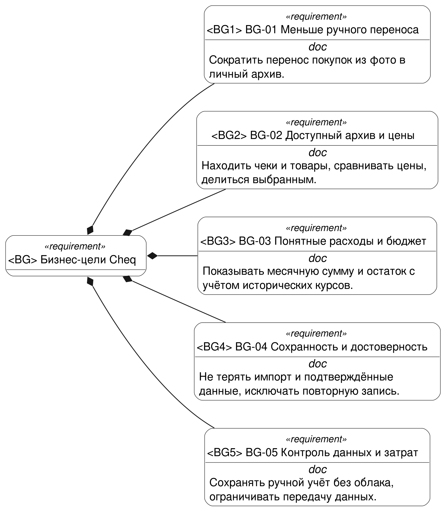

Источник: [03-business-goals.sysml](models/03-business-goals.sysml). Представление `Tree`.

### 5.2 Системный контекст

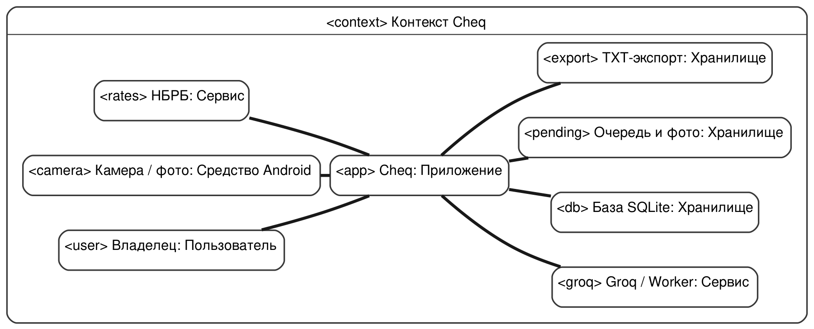

Источник: [01-context.sysml](models/01-context.sysml). Представление `Interconnection`.

### 5.3 Варианты использования

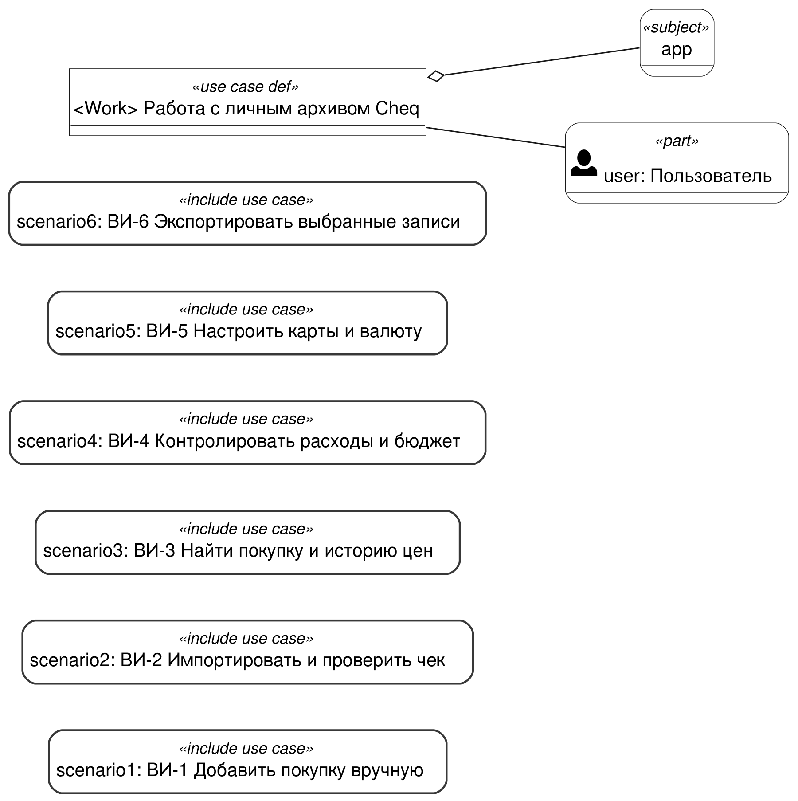

Источник: [02-usecases.sysml](models/02-usecases.sysml). Представление `Case`.

### 5.4 Состояния импортированного чека

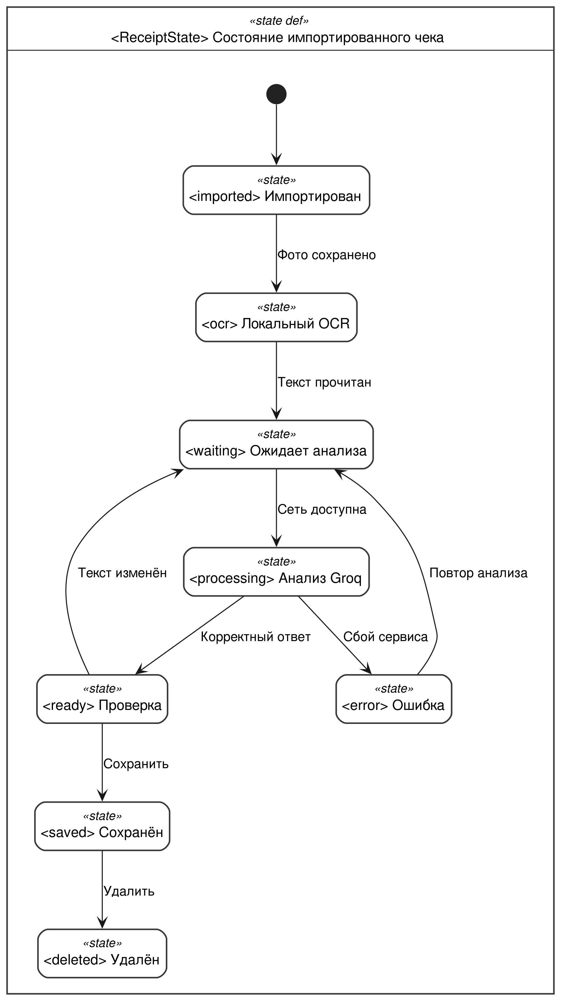

Источник: [04-receipt-states.sysml](models/04-receipt-states.sysml). Представление `State`.

### 5.5 Импорт и подтверждение покупки

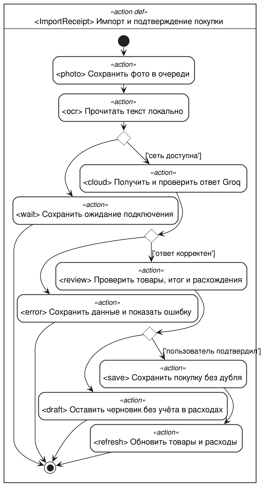

Источник: [05-receipt-import.sysml](models/05-receipt-import.sysml). Представление `Action`.

### 5.6 Карта экранов

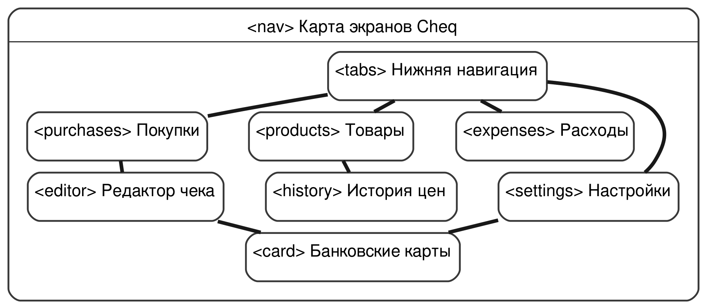

Источник: [06-gui.sysml](models/06-gui.sysml). Представление `Interconnection`.

### 5.7 Экран Покупки

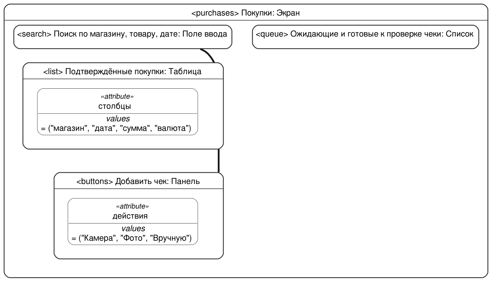

Источник: [06-gui.sysml](models/06-gui.sysml). Представление `Interconnection`.

### 5.8 Редактор чека

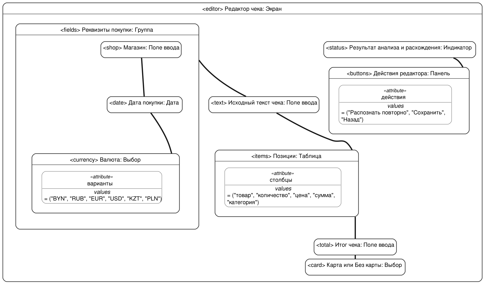

Источник: [06-gui.sysml](models/06-gui.sysml). Представление `Interconnection`.

### 5.9 Экран Товары

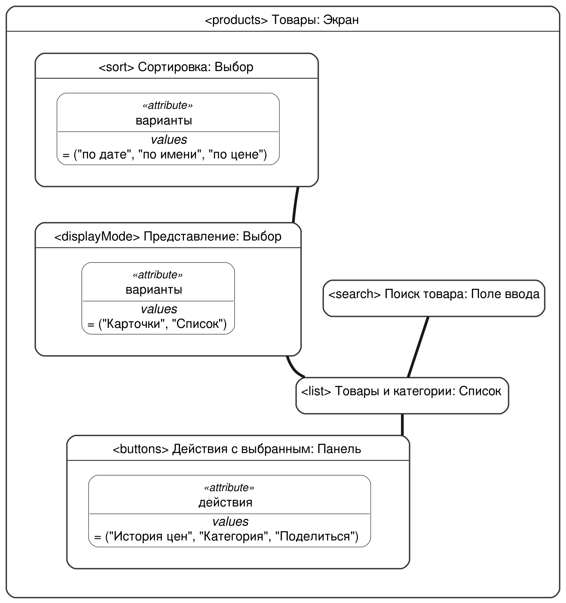

Источник: [06-gui.sysml](models/06-gui.sysml). Представление `Interconnection`.

### 5.10 История цен

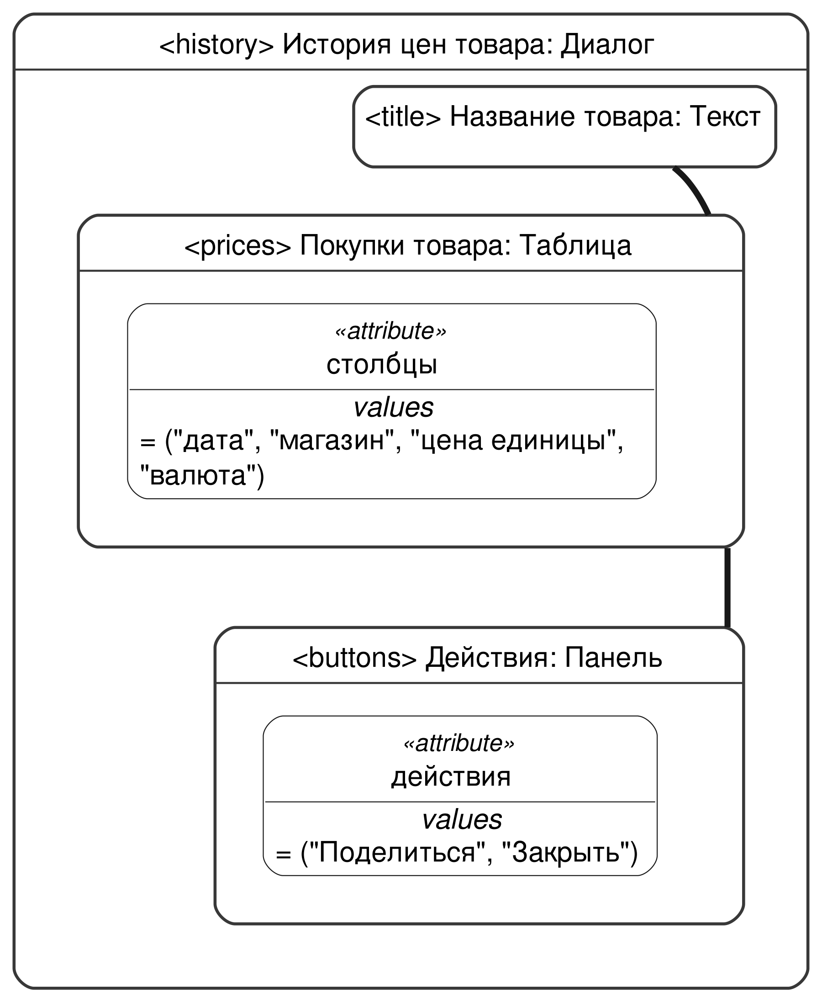

Источник: [06-gui.sysml](models/06-gui.sysml). Представление `Interconnection`.

### 5.11 Экран Расходы

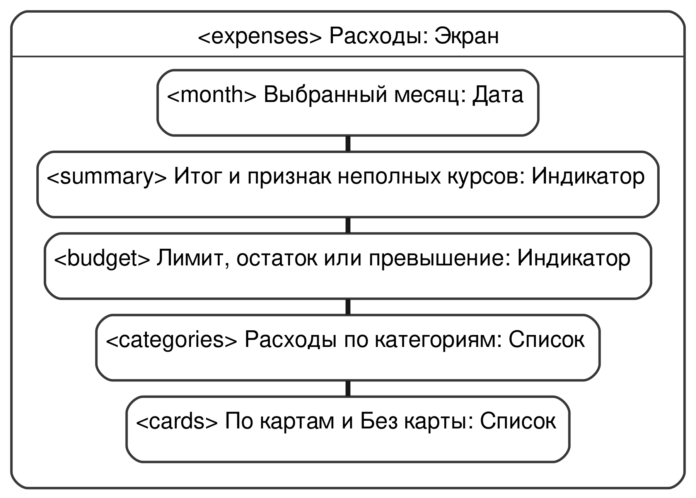

Источник: [06-gui.sysml](models/06-gui.sysml). Представление `Interconnection`.

### 5.12 Экран Настройки

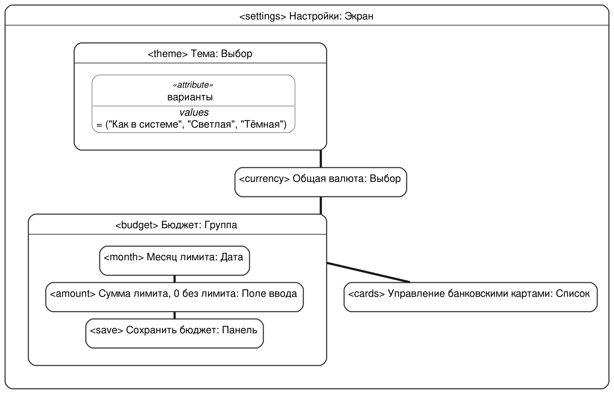

Источник: [06-gui.sysml](models/06-gui.sysml). Представление `Interconnection`.

### 5.13 Диалог банковской карты

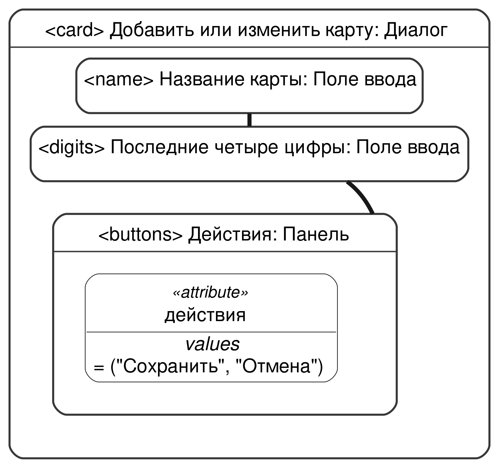

Источник: [06-gui.sysml](models/06-gui.sysml). Представление `Interconnection`.
